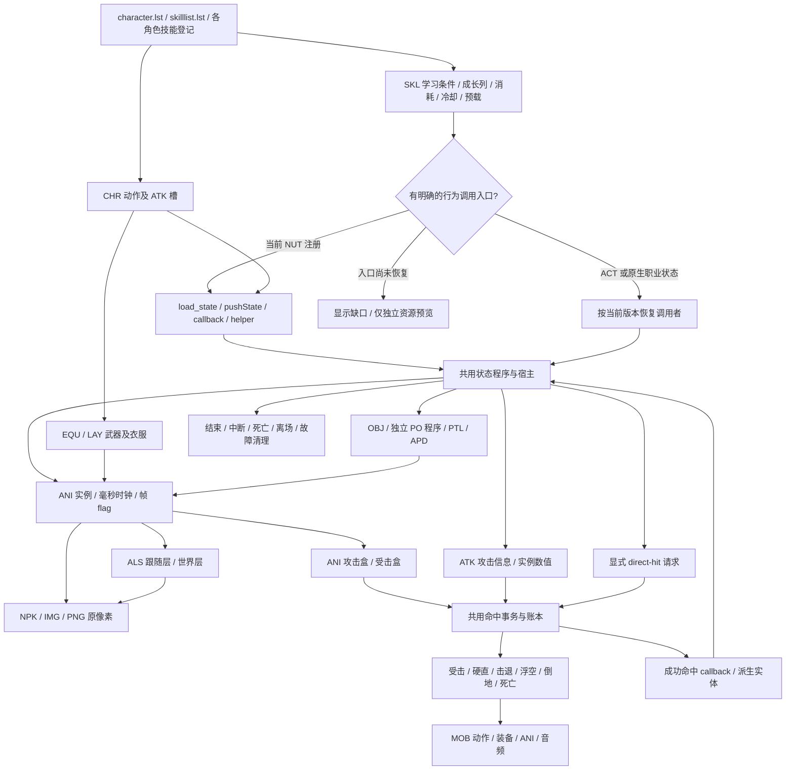
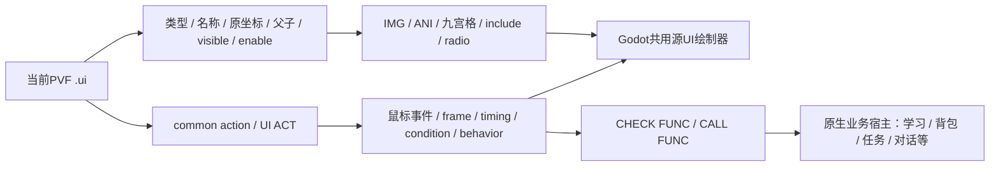

# 1031 角色、技能、受击与 UI 通用调用链

2026-10-21。依据本轮新增 `pvf-utils-info`、其余知识库和当前1031实际来源整理。
文件类型和 API 含义见 [知识复核](KNOWLEDGE-V2.md)；每条目录记录保存真实路径、哈希、顺序和注册依据。
下面描述需要恢复的完整体系，**不表示每个节点的所有能力已经实现**。

## 文件与调用者

SKL 不总能直接指明全部人物动作和特效。`[skill preloading image]` 是资源预载，不能决定哪个帧生成哪个实体。
CHR 的第几个动作也没有跨职业固定含义；由实际 caller 的槽号和 CHR 原顺序关联。
原生入口缺失时不能根据文件名相似、技能 ID 或预载资源顺序生成一个冒充完整技能的模板。
按职业恢复入口后仍应输出同一套程序和描述器，公共执行器不增加技能专用分支。

## 动作、图层、坐标与时间

| 层 | 实际依据和实例合同 | 当前 Godot 状态 |
| --- | --- | --- |
| 人物身份 | character registry → CHR；不同性别保持各自源身份 | 11注册角色均有自己的基础资源；不是全部职业技能完成 |
| 动作 | CHR 标签/出现次序/槽位 → ANI；ATK 用对应来源槽 | 1,430条可检索，按需播放；不是1,430个技能 |
| 装备 | 默认装备登记 → EQU job/layer/variation → LAY同动作槽 | 实际衣服/武器已接；完整换装属性与 expand 框资格仍缺 |
| 帧 | ANI frame → IMAGE、IMAGE POS、RATE、ROTATE、RGBA、DELAY、flag、声音、盒 | 按原毫秒播放；补 tick 扫过短帧，保留零 delay；CLIP/RGBA插值接入 |
| 图片 | 当前 ImagePacks2 NPK → 指定 IMG 帧 → 裁剪像素和 crop offset | 原像素/哈希可追溯；不把所有角色脚底统一对齐 |
| ALS | sidecar别名 → 父帧add/remove → 子时钟/坐标空间 | 同一路径不同别名独立；跟随与世界层分别消费 |
| PO | 注册ID → OBJ资源/ATK → 脚本/状态/运动/寿命 | 简单已闭合链可执行；复杂独立PO程序仍是缺口 |
| APD/PTL | 附加状态与粒子各自的来源/宿主调用/清理 | 保留依赖与诊断，未声称完整执行 |
| 音频 | 帧或NUT tag → audio.xml声明/权重 → SoundPacks成员 | 原OGG/WAV播放；随机声音独立表现随机流 |

坐标从地面世界 `(X,Y)` 与高度 `Z` 开始，屏幕纵坐标由地面Y减高度Z投影。
IMG裁剪原点、ANI图片偏移、EQU附件位置、caller生成偏移和地图/镜头分别保留。
跟随人物的层每次绘制组合父变换；世界特效在生成时锁定位置、方向和缩放，之后由自己的运动推进。
不能把当前女枪手脚下特效问题用所有角色统一Z补偿来掩盖。

普通输入检查成功后应从动作第一帧开始；动作提前结束、续段、蓄力、按住与松开须由调用者定义的状态/flag/input转移驱动。
不能统一给每个技能追加十秒停顿，也不能全局截断所有长帧：当前男女枪原ANI确实包含10000ms控制器等待帧，跳跃/倒地也有等待阶段。
**本版原动作浏览保留这些帧，尚未恢复男女枪原生普攻全部等待控制。**
这解释了源动画时长正确与实际原版操作时序仍不完整可以同时存在。

## 攻击与受击事务

1. 每次动作与独立攻击实体拥有实例身份；ATK是payload，不等于几何。
2. 每个有效源帧读取自身攻击盒，和目标当前受击盒在地面XY及高度Z三轴相交。
3. 身体、装备替换框、攻击PO和draw-only视觉保持资格边界；发光或ANI带框不自动取得攻击身份。
4. 目标过滤、方向、命中周期、次数与已命中对象账本先决定能否接受。
5. 接受后才提交伤害、受击、短停、声音和成功命中回调；MISS/重复拒绝不生成假爆炸或假受击。
6. 由ATK及目标状态选择硬直/击退/浮空/倒地/死亡，动作结束和落地事件继续推进恢复。
7. 销毁攻击PO、换状态、死亡、重置和故障同时清理所属层、计时器、保护和命中账本。

当前 demo 已有共同XYZ几何、去重、受击动画、击退/浮空/倒地/起身/死亡和两条源程序的真实命中验证。
训练HP/MP/速度、伤害/力度转物理、基础哥布林追踪是显式重建策略。
完整防御、异常、抓取、霸体/无敌、被动与装备成长、脚本direct-hit等尚未完整恢复，不能从基础命中测试外推。
怪物仍需从自身MOB/装备/ACT/AI进入相同执行器；本版哥布林不代表全怪物AI与背篓装备已完成。

## UI 链

322份UI文件均在源目录中可选择；首次按需导出，不假称已经逐份通过画面验收。
当前消费者覆盖父子/include、图片、九宫格、部分动画和radio状态。
特殊控件、完整UI ACT事件和native业务函数仍有诊断，源布局出现不等于交易/学习/任务已经生效。
文字继续使用当前fallback，未达到“菜单”“商城”两字字体复刻验收。
UI样例使用当前1031资源，未采用被禁用的DFQ UI素材或布局。

## 下一步仍按能力组推进

先扩展源编译器的typed状态入参/子状态/变量/有界循环和helper，再让每个PO复用相同VM，随后接动态坐标/移动/目标、攻击回调、appendage和被动消费者。
原生技能则恢复职业调用入口，输出同一IR。空回调可通用识别，但不跳过有副作用的未知API。
未知控制流、包宽、资源或退出链不完整时保持 `partial`，不提升可执行计数。

当前确实闭合的程序只有男法魔法旋风、圣职复仇之刺两条；其余状态和实际阻挡逐条记录于
`content/catalog-v2/actors/*.json`、`reports/catalog-v2/compiler-audit.json`。
本文件与机器全量扫描都不能替代用户前台画面、听音、手感和原版动态对照。
