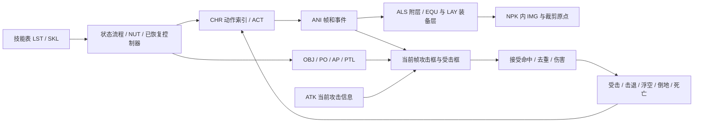

# Godot 技能演示：知识库复检与通用执行边界

日期：2026-10-21。本文用于独立 Godot 实验，主工程保持暂停、只读。本文是来源与设计结论，**不是所有技能已经实现或用户画面验收通过的声明**。实际演示内容、测试、启动入口以项目 README 和运行报告为准。

## 重新检阅了什么

本轮重新遍历 `D:/dnf-rebuild/dnf-部分知识库` 的全部 **6414 文件、76,442,648 字节**，重新读取每个源文件并计算 SHA256；抽取后得到 **4352 份独立文本、19,411,586 字符**。二遍源哈希无变化，抽取错误 0，未执行知识库代码。当前结果与旧审计的源清单身份一致，不能把旧摘要的“已经读过”继承为本轮语义验真。

- 全文件身份、编码候选和抽取状态：[source-manifest.json](../reports/knowledge/corpus/source-manifest.json)。
- 全文结构复检：[structure-review.json](../reports/knowledge/structure-review.json)。对全部独立文本扫描章节、标签、回调、关键词和作者不确定声明；领域统计相互重叠。
- 逐文件覆盖：[file-coverage.json](../reports/knowledge/file-coverage.json)。
- 实际语义阅读记录：[semantic-reading.json](../reports/knowledge/semantic-reading.json)。每份记录保存原路径、原字节/正文哈希及实际阅读区间；两份课程镜像分别保留身份。
- 复检工具：[review_knowledge.py](../tools/review_knowledge.py)。全库抽取调用主工程已有只读索引工具，输出全部在本项目 D 盘目录。

**全库读取/结构扫描与语义阅读分开计数。** 本轮语义阅读集中于三份适用 skill、ANI/ALS/ATK/SKL/MOB 格式、SKL/ACT/NUT 摘要、人物动作/装备层、官方注释相关章节和添加技能原课。未逐行审阅全部 4352 文档；66 个二进制、15 个未解码文件、6 个空文件保留明确状态。图片、外链和每份现代 NUT 的执行结果未因此变为已验证证据。

## 技能、贴图与判定是一套共享执行能力

资源与行为应按下面的关系组织；同一个播放/战斗执行器不应出现按职业选择算法的分支。

| 文件/对象 | 应负责的内容 | 不能据此直接推定的内容 |
|---|---|---|
| SKL | 身份索引关联、学习/消耗/CD、场景数表、固定/等级参数、资源预加载 | 预加载列表不是实际特效出生表；所有技能同一数值列不是同一用途 |
| CHR | 基础动作、顺序敏感的 etc motion / attack info、身体图像和基础属性 | 技能全部逻辑不一定在 CHR；文件名相似不能证明同一动作 |
| ANI | 帧顺序、毫秒延时、图像/偏移/变换/混合、框、声音、flag | 一段 ANI 不等于完整技能；脚本可切段、创建独立对象或直接命中 |
| ALS | 父帧上的附层事件、层号、别名、add/remove；其他指令需独立语义 | 触发字段不是毫秒；同一 ANI 不同别名可为不同实例 |
| EQU/LAY | 装备外观/变体/层、与身体动作对应的动画、替换武器图像及框策略 | 身体、武器的所有攻击框不能无条件相加；不同动作可能有不同装备 ANI |
| ACT | BASE/SUB ANI、帧/时间/命中触发、生成物件/动作切换/声音 | 仅播放 BASE ANI 不能称 ACT 已执行；未知行为不能空执行后报成功 |
| OBJ/PTL | 独立实体/动画、出生位置、轨迹、寿命、碰撞、跟随方式和销毁 | 弹丸不应固定在人物脚下；ANI 播完也不总是销毁条件 |
| ATK | 攻击对象类别、伤害类型、受击反应、推力/浮力、命中声音/暂停、异常 | 它不是几何框本身；字段存在不等于完整伤害公式已恢复 |
| MOB/AI | 基础动作与装备、攻击/ATK/CD索引、条件选动作和移动、受击/死亡素材 | 怪物不是只能换贴图共用同一攻击；模板 AI 不能冒充原版 AI |

## 关键原文依据

路径均相对 `D:/dnf-rebuild/dnf-部分知识库/`。普通文本引用源文件 1 起始行号；JSON 课程引用课程号及 `reading-corpus.jsonl` 的提取正文行号，**不是 JSON 原始行号**。

| 结论 | 原始来源与位置 |
|---|---|
| ANI 的 DELAY 是毫秒，图片/偏移/框分开记录 | `dnf-pvf-tutorial-master/pvfCourse/【12】高级教程/ANI/11580_ANI基础知识点.json`，正文 19–41；单位明确在 25 行 |
| ALS 自动寻找完整 `.ani.als` 名称，按父动画帧触发，别名是实例身份的一部分 | `DNF-PVF-file-Reference-main/参考资料/sample(官方注释)/sample.ani.als`，17–36、41–43 |
| ALS 有前后层关系，none-effect 不是“省略特效” | 原课 `11665_关于.als文件的解析.json`，19–41；其更深渲染含义仍须当前字节/运行证据 |
| 装备层可以多次声明，EQU 指向 LAY；角色动作索引与装备动作需对应 | `.../sample(官方注释)/avatarsample.equ`，32–38；`equipmentsample.equ`，264–268；`charactersample.chr`，287–324 |
| 替换武器 ANI 是否提供攻击框有显式选择 | `.../sample(官方注释)/equipmentsample.equ`，323–328：expand ani 第三参数决定攻击范围来源，第四参数决定声音来源 |
| ACT 能通过 SUB ANI 直接补怪物装备；声音也是动作内容 | `.../sample(官方注释)/actionsample.act`，1–35；示例引用 `equipment/monster/goblin/...` 的裤子与武器层 |
| ACT 物件出生含相对 XYZ，方向、基点、地图绝对位置、跟随各有开关 | 同 `actionsample.act`，387–405 |
| 跟随与独立世界位置必须区分 | `.../sample(官方注释)/passiveobjectsample.obj`，134–138：parent/from parent/keep position/none |
| 生成高度是独立的 Z，不能套一份全职业脚底修正 | `.../sample(官方注释)/newmonstersample.mob`，514–519：throw frame 和 projectile start x/y/z；`particlesample.ptl`，3–29 |
| 攻击反应、命中暂停、声音和异常属于当前攻击信息 | `.../sample(官方注释)/attackinfosample.atk`，3–19、31–37、45–62；第四 hit-info 参数是 hit-delay 倍率，**不是血液大小** |
| 技能由输入检查→状态→ANI/ATK→定时/flag→命中/AP→退出清理驱动 | 原课 `11724_nut解读.json`，12–56、58–149、151–216、227–303 |
| 有些技能直接向已选目标发送命中，不依赖攻击框 | 同原课 182–193；因此“所有伤害都只是框重叠”不完整 |
| 添加技能涉及 SKILL/STATE/CUSTOM_ANI 三个不同身份及 CHR 动作序号 | 原课 `11910_新手添加NUT技能的几个地方讲解.json`，14–42；`11919_关于加单兵推射NUT文件的几个地方讲解（@魔化你姐的心）.json`，8–34 |
| 技能、角色级、PO、AP 回调属于不同对象和生命周期 | 原课 `11730_大佬合并函数心得.json`，6–37、59–104；原课 `11750_nut简介（注解）.json`，148–238 |

“添加人物/角色”标题关键词检索没有找到一份可直接证明当前 1031 完整添加新职业流程的文本；找到的是 CHR 动作教程、添加 NUT 技能、装备/动作教程和 `11715_男格斗动作修复原理`。后者正文主要是图片与网盘链接，不能把未查看图片的内容充作已恢复实现。

## 必须拦截的知识库冲突

1. `dfo-pvf/.../als_format.md` 把 add 第一参数描述为时间、draw-only 第一参数描述为绘制层；官方 ALS 样例和既有 1031 审计明确应按父帧，不能照搬。
2. `dfo-pvf/.../skl_format.md` 把 skill class 当职业身份；同一职业当前 SKL 可有不同值，职业身份仍来自注册列表。
3. `NUT文件知识库/高级示例/DNF引擎调用机制深度解析.md:75–92` 把 pushState 第五参数当优先级并混用 AP 风格生命周期。既有当前 1031 注册证据表明第五参数为技能 ID；技能/AP/PO 回调必须分族。
4. `ANI文件知识库/标签参考.md:254–278` 将框六数写成两端点，dfo 摘要则是 XYZ+宽高深。保留六个原数，按照当前 1031 解析/运行合同解释；不能据社区模板改几何算法。
5. 同一 ANI 标签参考把 IMAGE RATE 说成 100 为原大，其他资料/当前二进制读 float。要从当前字节和值域/实际消费者确定单位。角度正负在资料间也冲突，不直接继承。
6. `ATK文件知识库/标签参考.md:246–285` 将 push/lift 当固定像素位移/高度，官方样例写“力”；`:519–520` 把 hit-info 第四项当血液缩放，官方写暂停倍率。**这些不能直接变成运动/特效公式。**
7. `CHR文件知识库/03-动画标签/动画标签详解.md` 的 stay/attack1/skill 等模板标签及固定优先级，与当前 CHR 的 waiting motion/attack motion/etc motion 不能直接互换。
8. 官注 ATK 的 HP/MP drain 标为未实现；社区文档却将其描述为已生效能力。字段枚举不是版本实现证明。
9. 知识库现代 NUT/UI 包混有新职业、后期资源与直接改伤害逻辑；可以学习调用模式，不能作为 1031 的同版控制器直接整包导入。

先前详细冲突/当前 1031 成员字节证据仍保留在 `dnf-native-demo/reports/knowledge-base-audit/`；当前 demo 导出的源成员身份应以本项目资源 manifest 为准。历史 1031 PVF 身份为 `d13ce454567197bb4617cad4d0e472f609a1ec5cf2256462d780547be878607d`，不能仅复制这个字符串冒充本轮实际校验。

## 给 Godot 的共享执行合同

这是一份通用实现建议；实际支持范围需由运行报告列明。

- **Actor** 保存世界地面 XY、高度 Z、朝向、生命和受击状态。屏幕投影与物理坐标分开；渲染不反过来修改碰撞。
- **AnimationInstance** 保存原始帧顺序和毫秒时长、当前实例/循环/帧访问身份。首次输入应能显示首帧；补 tick 要派发所有越过事件；一帧事件不能因多次绘制重复执行。每个独立特效从实际出生时刻开始计时。
- **LayerBinding** 用数据选择身体、装备、ACT 子层和 ALS 附层，保留原图层号/偏移/裁剪原点。翻转发生在统一局部坐标变换，不能把纹理重新脚底对齐；装备框来源必须显式声明。
- **EffectEntity** 明确 owner、出生世界坐标或跟随模式、局部 XYZ、朝向、独立时钟与结束条件。创建并非永久跟随；销毁清理不依赖某个职业名字。
- **AttackInstance** 保存 owner/action/stage/epoch、当前 ATK、可选身体/装备/PO 的有效框、命中目标账本和再次可命中的明确条件。一次动作多帧/多图层同时重叠不应无意重复伤害。
- **HitTransaction** 先过滤队伍、保护和重叠，再发布被接受命中。命中表现、伤害、反应共用这份结果；空放不应产生怪物受击和命中特效。脚本直接命中是另一种显式入口。
- **HitReaction** 按数据选择普通受击/倒地/浮空/死亡动画。Z 运动、击退、硬直与死亡切换共用执行器；未恢复的力→速度/重力公式须标为实验策略。不能用每个怪物一个新控制器实现相同反应。
- **AI** 数据给出观察距离、攻击范围、节奏、动作/ATK；共享调度决定追踪/攻击，攻击仍走同一动画与命中链。演示用基础追踪 AI 必须标为实验 AI，不能声称已恢复全部 MOB AI 指令。

共同描述数据至少保留 `source(member, sha256, offset/section)`、动作与图层、原始毫秒、框六数、效果出生事件、坐标模式、ATK 选择、命中周期和退出条件。输入允许、蓄力/按住、弹丸、持续命中、抓取、Buff 应是可组合能力。缺失行为应有具体诊断，不能通过“同一普攻套所有技能”计作通用适配。

## 相对当前主工程的结论

主工程已经有共享资源读取、帧时钟、ALS/效果、攻击/受击、ACT 与部分 AI 消费者，不能说完全从零逐技能实现；但技能接纳仍有明确逐技能分支、来源白名单和受限脚本形状。当前 `monster_action_ai_world.cpp` 也明确记录 DestinationSelect/MoveMethod 尚无完整实际消费者。

这次独立实验应验证：**换一份角色/技能描述即可复用同一个执行器，真实原图与帧时长仍正确，攻击框能打中基础怪物并驱动其受击/倒地/死亡。** 它可以比较 Godot 的适配和调试便利，但有限技能演示不能证明全部职业与全部原生 AI 已自动适配，也不能代替原版动态比较。
