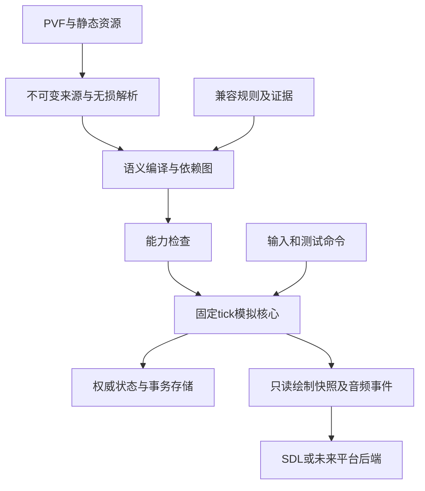

# 01 总体架构与公共契约

版本v1.1 · 2026-10-18 · 状态：设计待实施。

## 1. 架构与增量迁移

沿用C++17、dnf_core、现有解析器和SDL2。先提取窄接口，再将现有World／Progression／main逻辑迁入对应服务；保留兼容facade直至调用方迁移完成。不引入另一套内容权威或为每职业复制World。



层次：来源层保存字节和身份；内容层描述不变定义；规则层解释字段；模拟层管理实例；表现层消费结果；平台层提供设备。EXE地址仅用于查证，不作为运行函数指针。

## 2. 公共身份与数据类型

| 类型 | 最小合同 |
|---|---|
| ContentProfile | 独立PVF、静态根、编码、兼容/规则/解析器身份 |
| SourceRef | 包身份、成员路径、成员hash、字段offset、scope、ordinal、原字节范围 |
| ContentKey | 内容集身份＋类型＋注册ID；无ID内容使用精确源路径；保留注册alias |
| CharacterIdentity / SkillKey | 沿用job/growtype/awakening和job/skill；不把技能ID当全局ID |
| EntityHandle | uint64实例ID＋generation；不暴露长期裸指针 |
| ActionId / AttackId | 本次run单调唯一ID；持久化序列，不能重载后与旧事件撞号 |
| EventId | run、producer、instance/epoch、源事件ordinal、序列；不依赖地址或墙钟唯一性 |
| SimTime / SimDelta | 明确单位的整数/有理数；禁止与SDL时间直接相加 |
| RuleProfile | 已冻结的策略集合、参数、版本、hash、适用范围 |
| OperationResult | 成功/拒绝/未知/故障分开，错误码、source、原因链；UI负责翻译 |
| RenderSnapshot | 只读绘制实例、HUD数据和诊断引用；不持有可变模拟对象 |

命名空间区分玩家、怪物、物件和道具注册ID。同一源路径可有多个注册ID，不擅自合并身份。ContentKey与可变EntityHandle不可互换。

## 3. 服务接口边界

```cpp
// 示意合同，名字为设计建议，不表示当前全部存在。
CompiledContent compile(ContentKey, const ContentContext&);
CapabilityResult assess(ContentKey, const CapabilityContext&);
RequestResult requestAction(EntityHandle, const CharacterActionRequest&);
void advanceSimulation(SimDelta);
DerivedStats evaluateStats(const StatInputs&, const RuleProfile&);
DamageResult evaluateDamage(const HitContext&, RandomStream&);
OperationResult submit(const GameCommand&);
RestoreResult restore(const SaveSnapshot&, const ContentContext&);
DebugReceipt submitDebug(const DebugCommand&);
RenderSnapshot snapshotForPresentation() const;
```

CharacterController request/tick/cancel与CharacterSkillState保留并扩展。ObjectDefinition/Instance/System已存在，不新建第二套物件账本。Progression逐步成为Inventory/Equipment/Quest/Economy/Loot服务的兼容入口。

业务服务通过只读定义和权威状态访问资源；UI不能绕过服务改等级、金钱或任务。动画、音频和日志消费者不能自行发奖励。

## 4. 线程与权威状态

推荐首版模拟单写者。SDL事件在主线程采集并排队；模拟按固定tick消费。资源IO和解码可在工作线程，GPU纹理创建/销毁回到对应renderer线程。异步结果带profile generation和请求token，切图/取消后丢弃过期结果，不能把旧图加载回新场景。

存储提交由同一权威执行序列协调；磁盘写可由单独worker完成，但提交发布前不能允许后续依赖命令绕过未完成代。首版先使用串行保存确保正确，性能优化后也必须保持同样可见顺序。

UI读快照；音频回调只消费预备数据，解码与存储不持有音频实时锁。不可变内容可共享；动画实例、攻击登记、随机流与脚本对象不可跨实体共享可变状态。

## 5. 随机、时钟和算术

固定模拟60Hz，保留现有ns×60与1e9比较机制；不要改为每帧16ms。帧内源事件可驱动事件子区间，但已恢复的离散运动按原tick算术一次执行，只有声明支持子步的运动才分段积分；接触采样/扫掠同样按明确策略。原生单pending事件与全跨越时间线分别保持自身语义，不冒称已经恢复原生全部事件调度。

推荐PCG32作为重建默认随机算法，以显式版本和固定宽度实现；种子派生采用项目固定哈希算法/字节编码，禁止std::hash和未规定实现的std::uniform_distribution。世界生成、AI、战斗、掉落、粒子、音频分别随机流；表现变化不改变掉落。映射到整数区间用拒绝采样避免模偏差。算法及状态持久化，不宣称PCG32为原生算法。

来源float32运算按消费者保存；已恢复算术模块沿用其禁止fast-math／FMA重排要求。整数乘法、中间累加及货币溢出显式检查。全平台逐位一致尚未验证；同构建重放一致与跨平台误差验证分开。

## 6. 事件和错误合同

事件区分请求、已提交领域事实、表现通知。例如SkillRequested不等SkillCommitted；Contact不等DamageApplied；ActorDied只发一次，VisualRemoved不再触发击杀。

请求可拒绝而不改变状态；编译错误阻止依赖内容开放；运行故障停止受影响动作并按所有权清理，保存诊断。错误不返回伪成功，不默认为零奖励或零伤害后继续标complete。

未知字段不自动视为致命，也不自动忽略：语义适配器声明是否影响必需能力、可选表现或仅保留元数据。无分类的执行指令默认未支持。诊断含profile、content、source offset、controller、instance、tick和strategy。

## 7. 数值与事务的边界

一次施法的MP/CD状态提交属于内存模拟事务，不要求每次攻击同步写盘；涉及奖励、物品、学习、购买等持久化操作进入GameTransaction。检查点包含同代世界状态、pending事件、随机流和奖励账本，断电可以回到上一已提交代，但不能跨代拼接出重复物品。

调试数值也通过命令，不能跳过基本不变量。影响初始化的规则在下一副本生效；测试开关与内容定义分开保存。

## 8. 完整模块边界

[模块覆盖清单](appendices/module-coverage.json)逐项对应资料库25类系统，声明required/conditional/deferred_boundary及原因。必需职业技能依赖的召唤、异常、任务和装备机制始终required。区域能力开放不是降低最终职业门槛的工具。

远程业务本轮不实现网络协议，建立LocalGameServices接口承担单机成长、任务、交易；未来网络权威可以替换服务，但不为尚未要求的联网重构整套模拟。

## 9. 任务和验收

P01落实身份；P03落实时间/事件/句柄；P04落实提交；P05–P17接入服务。先写接口合同与已有行为兼容测试，再移动实现；迁移期间同一业务只能有一个权威写入口。

验收：不同job相同skillId无冲突；失效generation拒绝；跨profile异步结果不落入新场景；重载事件ID不重复；音效/粒子开关不改变战斗随机；服务失败无半提交；新职业不依赖鬼剑士内部状态。任何接口引入SDL、Windows句柄或资源绝对路径到核心模型都须审查并移回后端。

## 10. 来源

[核心资源接口](../dnf-native-demo/include/dnf/resources.hpp)、[控制器接口](../dnf-native-demo/include/dnf/character_controller.hpp)、[物件接口](../dnf-native-demo/include/dnf/objects.hpp)、[构建边界](../dnf-native-demo/CMakeLists.txt)、[准备度25类](../dnf-result/research/new-version-readiness.json)。
