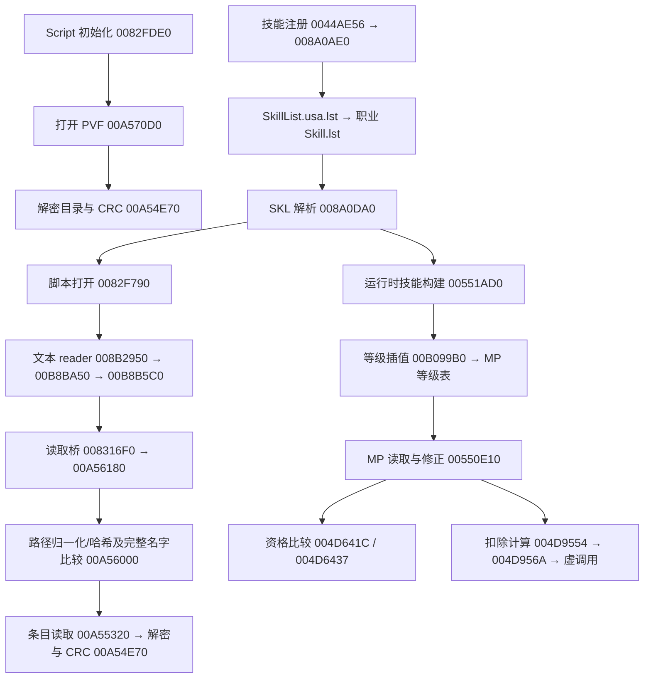

# 60US DFO：PVF 消费链调查

调查日期：2026-10-19。工作根目录：`D:/dnf/60US`。

## 结果与范围

已从现有修复版客户端定位 PVF 的打开、路径查找、文件读取、解密校验、文本脚本读取、职业技能注册、SKL 属性解析、等级数值生成，以及 MP 释放资格检查和扣除代码。当前 PVF 的全部 **99,501** 个条目均在 Python 与独立 C++ 实现中通过解密后的 CRC 校验。

**没有恢复完整客户端的原始 C++ 工程，也没有独立完成原版 EXE 的动态脱壳。** 本轮利用目录中已有的 `DFO_fixed_v3.exe` 展开代码做静态逆向，输出 24 份 C 风格伪代码、24 组汇编/原字节片段，以及可编译的 PVF 核心重建源码。本轮没有运行游戏，没有把静态分支分析记作真实释放技能的动态验证。

`pvf60_verify.cpp` 是依据机器指令重写的独立验证器；`decompiled/*.c` 是自动反编译结果，两者不能视为原始源码。报告中的描述性函数名由本次调查赋予。

## 样本身份与壳

| 文件 | 字节数 | SHA256 |
| --- | ---: | --- |
| `DFO/DFO.exe` | 5,741,240 | `583928ddc0391396401440bd76391521b138c616b235ed18e615d5ab7333960a` |
| `DFO/DFO_fixed_v3.exe` | 16,859,648 | `a3177551b8f7373e042865b0e99022e24e6ffd47298299a50dc97fec5254745b` |
| `DFO/Script.pvf` | 140,179,584 | `23538ef1967baec4947c89ea0363cdce66230a3949b662faf54f7558673d7a98` |

原版为 x86 PE，ImageBase=`0x00400000`，入口 RVA=`0x0100E000`；主体节高熵（约 7.986），存在 `Themida` 字符串及随机节名，符合加壳特征。

修复版入口 RVA=`0x00805078`；主体节已展开为 `.text`，raw size=`0xEAC000`，熵约 5.568，存在 `.SCY` 导入修复节和 `.chui` 追加节。这些特征符合已有脱壳/修复产物。仍有 Themida/WinLicense 残留，不证明整个程序每个函数均已恢复。

服务端工具包内的 `client-overlay/DFO_fixed_v3.exe` 与客户端修复版 SHA256 相同；两处 `Script.pvf` 也相同。复核源文件哈希未变，结果在 `verification.json`。本轮只写入 `analysis/` 及技能安装目录。

以下地址只适用于上述修复版 hash。VA 是加载基址加 RVA；文件偏移由 PE 节表换算，不将其作为其他版本的地址。

## 实际调用链



图中是静态指令所证明的路径。文本 reader 与编译脚本 reader 共用分派对象；当前 PVF 提供文本 SKL/LST，不能据此假定编译脚本分支不存在，也没有动态观测启动时的全部模式开关。

## PVF 容器与解密

头部实测：GUID=`13ff9a94-0204-0410-845a-ceeffe637190`，版本字段=`71295`，目录树长=`7,566,568`，目录 CRC=`0x51647FBE`，条目数=`99,501`。数据基址为 `56 + tree_length = 7,566,624`。目录解析使用 `7,566,567` 字节，最后一个字节为零填充。版本字段是容器数值，不把它解释为客户端发行版本号。

每个目录条目依次为：`u32 path_hash`、`u32 path_length`、ASCII 路径原字节、`u32 logical_size`、`u32 crc`、`u32 data_relative_offset`。本样本所有路径严格 ASCII 解码成功。

原生 `0x00A55FA0` 建立的条目子结构字段为：`+0x24` 原长度，`+0x28` 向上对齐到四字节的长度，`+0x2C` CRC，`+0x30` 相对偏移。其外层含路径哈希；内存记录步长为 `0x3C`，不能将内存结构直接当成磁盘结构。

`0x00A54E70` 对四字节对齐的数据执行：

```cpp
clear_word = ror32(encrypted_word ^ expected_crc ^ global_key, 6);
valid = CRC32(clear_padded_bytes, crc_seed) == expected_crc;
```

CRC 使用反射多项式 `0xEDB88320`。目录树 seed 为条目数；内容 seed 为该条目的路径哈希。对齐填充参与 CRC，导出时再截到原始长度。原生函数使用寄存器和栈混合传参，不能直接相信自动生成的函数原型。

固定密钥全局位置为 VA=`0x010D427C`，修复版文件中实测为零。**当前 PVF 的实证密钥为 `0`**：Python 与 C++ 均对全包校验成功。直接套后期常见的 `0x81A79011` 会导致目录 CRC 失败。本轮没有发现该内容层需要解压的证据；不能把解密称为已证明的“解密后再 zlib 解压”。

路径哈希函数 `0x00A54F80` 从 `0x1505` 开始，对非空 ASCII 路径执行 `h = h * 33 + byte`，**包括结尾 NUL**。全部 99,501 项均与此计算匹配，目录按此哈希排序。

哈希只有 99,500 个不同值。`0xCA845792` 对应两个路径：

- `stackable/cash/christmas_packft.stk`
- `character/swordman/effect/animation/kalla/finish2-2.ani`

原生 `0x00A56000` 先定位哈希，再遍历同哈希记录并比较完整路径。重建索引必须保留碰撞，不能写成 `unordered_map<uint32_t, Entry>` 并静默覆盖。

## 文本分支与版本差异

当前样本没有 `stringtable.bin`。实测 LST/SKL 是带韩文注释的文本，示例以 **严格 CP949** 解码成功。`samples/` 同时保存未改动的解密原字节、UTF-8 阅读副本和逐文件 SHA256/偏移/CRC 清单。这个观察不等于全包所有文件都使用同一编码，也不把其他版本已知的 GBK 规则套到本包。

`0x0082FDE0` 检查 `_CompiledScript` / `!CompiledScript`、`_ScriptPacks` / `!ScriptPacks`；分派对象位于 `0x01051228`。`0x008B2950` 的模式零分支进入文本 reader；`0x008B2970` 的模式一分支进入另一套 token reader。因此源码重建应保留模式分层，不能把后期五字节 token 解析器直接用于本包文本。

读取桥 `0x008316F0` 包含包内读取及外部文件分支，包读取进入 `0x00A56180`。本轮恢复了相关分支和字节，未运行游戏验证实际启动参数与每次资源读取采用的分支。

内容清单中有 690 个 SKL、7 个 CHR、54,531 个 ANI、2,067 个 ATK、3,165 个 ACT、1,871 个 MAP、22,095 个 EQU。本包清单没有 `.nut`。这些是文件数量，不是已开放职业/已完成技能数量。

## 技能到 MP 消费的具体证据

启动调用点 `0x0044AE56` 将 `Skill/` 和 `SkillList.usa.lst` 传给 `0x008A0AE0`。当前列表注册六个职业索引：Swordman、Fighter、Gunner、Mage、Priest、ATGunner。`0x008A2940` 枚举对应职业列表，将技能路径传给 `0x008A0DA0`，再登记技能 ID 与名字。

本包 `skill/swordmanskill.lst` 中 ID=`5` 是 `Swordman/HardAttack.skl`，ID=`46` 是 `Swordman/UpperSlash.skl`。两者均已解密并通过 CRC。

HardAttack 原始大小 1,305 字节，PVF 绝对偏移 `7,906,924`，路径哈希=`0x00D2D1FC`，CRC=`0x94E7BC98`，解密内容 SHA256=`1cc0c639f70efab493d8d9d38ebb438c21c6132a5f6b3ff3e7e8d38b88e7f846`。其中有：

```text
[maximum level] 30
[weapon effect type] `[magical]`
[dungeon]
[consume MP] 24 60
[cool time] 6000 6000
[static data]
100
[/static data]
[level info]
1
250
263
...
```

这里只节选显示；完整顺序、作用域和注释在样例文件中保存。`static data` 的 `100` 注释描述的是鬼斩特效放大比例，不能因此当作全技能通用伤害字段。

1. `0x008A1682` 引用 `[consume MP]` 字符串，比较成功进入 `0x008A1694`。循环读取两项浮点数，写入属性对象 `+0x180` 和 `+0x188` 对应的受保护数值包装。第三个参数属于 `0..5` 时走直接读取分支，其他值还有乘数操作；当前注册的六职业都属于直接读取分支，不把其他上下文的解析规则合并进去。
2. `0x00551AD0` 重新调用 SKL 解析器，随后按技能等级生成运行时数据。MP 表写入过程可在 `0x005528C9`–`0x00552948` 核查，插值调用点为 `0x005528CE`。
3. `0x00B099B0` 可清晰还原为带端点钳制的线性插值：`(last-first)*progress/steps + first`；`progress>=steps` 返回末端，`progress<=0` 返回首端。调用者随后使用 `0x00C01544` 做浮点转整数。精确舍入还依赖 x87 运行状态，本轮不把静态公式当作已动态确认的最终扣蓝公式。
4. `0x00550E10` 读取运行时 `+0x184`..`+0x188` 表区间；传入等级 `-1` 时使用当前等级，并对表边界作检查。存在角色相关修正、武器效果类型分支及其他修正调用。这个 getter 不是简单返回 SKL 第一项。
5. `0x004D641C` / `0x004D6437` 调用该 getter，将结果与角色 `+0x1238` 对应数值比较，不足时跳到拒绝分支；另有 `0x004D91EF` 的不足检查路径。
6. `0x004D9554` 再次取得消耗，`0x004D9565` 读取角色当前数值，`0x004D956A` 执行减法，`0x004D956F` 通过虚表 `+0x3F4` 提交结果。结合 SKL 来源、getter 数据流及同字段资格比较，这是目前最完整的一条 PVF → 运行时数值 → 消费链。

角色 `+0x1238` 不是可直接改写的裸 int；相关读取经过 `0x00402060` 等受保护数值接口。SKL 属性对象也有同类包装。仅从反编译变量类型推定结构会丢失其存储语义。

CHR 中还保留 `Animation/HardAttack.ani`、`AttackInfo/HardAttack.atk` 等依赖，这些文件名/有序列表是数据证据。**本轮没有闭合 HardAttack 控制器选择 ANI/ATK 到最终渲染和命中结算的全部动态调用链**，不能把同名依赖当成已经恢复技能行为。

## 产物与复现

- `inventory.json`：PE 结构、导入及三个源文件 SHA256。
- `pvf/summary.json` / `pvf/entries.json`：全包校验结果、碰撞和条目索引。
- `pvf60.py`：只读 Python 解析、校验和指定文件导出。
- `pvf60_verify.cpp` / `pvf60_verify.exe`：无第三方运行依赖的 C++ 重建验证器源码与已编译程序。
- `samples/manifest.json`：七个样例的原字节与阅读副本来源信息。
- `evidence/index.json`：24 组关键指令片段的 VA、RVA、文件偏移和哈希；同目录保存 `.bin` 与 UTF-8 `.asm`。
- `decompiled/all_outputs.json`：24 份 C 风格伪代码及其哈希。部分原型、寄存器参数、SEH、受保护字段和类型推断有误，必须回看 `evidence/`；这些文件不承诺可以编译。
- `verification.json`：独立实现校验一致、错误密钥拒绝、源文件未变及工具状态。

在工作根目录运行：

```powershell
python -X utf8 analysis/pvf60.py --verify-all
python -X utf8 analysis/pvf60.py --extract skill/swordman/hardattack.skl skill/swordman/upperslash.skl
analysis/pvf60_verify.exe DFO/Script.pvf
```

Python 容器读取器只用标准库。二进制扫描工具另依赖 `analysis/deps/` 的 pefile、capstone；反编译依赖 `analysis/angr_deps/`。原生验证器使用本机已有 LLVM-MinGW 的 clang++，参数为 `-std=c++17 -O2 -static`。

安装了 `C:/Users/16908/.codex/skills/ghidra-rpc`，来源为 `https://github.com/cellebrite-labs/ghidra-rpc`。官方技能目录中未发现名为 `rep` 的技能，用户所指的具体仓库尚未确认；没有把这个替代项声称为 `rep`。技能下一轮可发现。官方 Ghidra 发布包下载缓慢且未完成，已停止；**Ghidra RPC 运行环境尚未就绪**。本轮实际使用 pefile、Capstone、angr 完成静态分析和伪代码生成。angr 的可选 Unicorn 模块不可用，不影响本轮静态 CFG/反编译；未进行指令仿真。

## 后续可直接接续的位置

优先在匹配修复版 hash 的进程中观察：`0x008A1682` 的字段解析、`0x005528CE` 的等级插值参数、`0x00550E10` 的最终 MP、`0x004D9554` 的释放提交，以及 `0x00A56180` 的实际读取路径。记录角色职业/技能等级、武器、模式、命令输入、MP 前后值和 x87 状态，才可闭合最终数值一致性。

再从具体技能控制器追踪 CHR 的动作/ATK 索引、ANI/ALS/PTL 生命周期与 NPK 读取。不要直接把本报告的六职业列表、地址、密钥或文本模式移植为本地 1031 客户端的事实。
