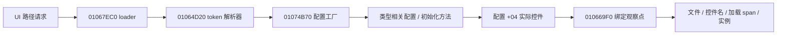
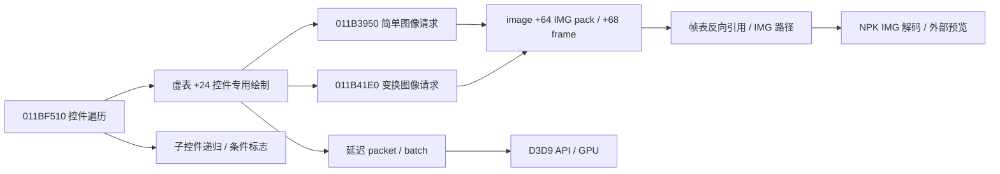

# 原生加载及绘制契约

所有地址为当前 1031 的 VA，基线主模块起点 `0x00400000`。DLL 用 RVA 定位，并在安装前逐字核对守卫。入口 patch 只复制已知长度的无相对控制流指令；末尾 ret 的跳板单独测试。寄存器、标志、x87/SSE/MXCSR、DF 和 LastError 均须保持。

## 加载和实例化

`0x01067EC0` 是 thiscall，ECX 为加载器，栈上传入 UTF16 路径、两个参数；返回 AL，`ret 0x0C`。代码检查加载器 `+0x24`，对路径做格式检查，必要时设置加载器 `+4` 的路径，最终调用 `0x01064D20`。`+0x18` 会影响路径写入分支，但不能仅凭这个数值宣布某次 PVF cache hit。

成功出口 `0x01067F58` 和失败出口 `0x01067F5F` 与入口配对；异常退出不能伪造成功。每个线程保存有限加载栈，绑定时还沿 EBP 链验证加载器帧和原返回槽确实仍在调用栈上。没有找到该帧时只保留原始事件，不推测来源。

`0x01074B70` 返回的是配置对象。配置工厂可以处理 button、image、text、animation、editbox、tabgroup 等多种类型。其具体参数仍取决于类型。`0x011D5270` 的精确代码是 `8B 41 04 C3`，只返回配置 `+4`；它不是实例工厂。`0x010669DB` 从局部配置调用此 getter，`0x010669E6` 保存返回值到 EDI，空值直接跳走。因此选择 `0x010669F0`，此时 EDI 是已存在的控件，配置指针在 `[EBP-0x1D0]`，控件名字符串对象在 `EBP-0xB0`。关联不使用“最近加载的 IMG”。

字符串对象布局包含迭代器代理：数据 `+4`、长度 `+0x14`、容量 `+0x18`；UTF16 容量小于 8 时使用内联数据。仅复制已校验的有限长度。资源路径和控件名的采集不读取 editbox 的输入内容。

窗口属性解析器可识别 `[title string]` 等标签，但其中的 `+0x1C4` 是配置结构成员，尚不能当作通用运行时标题字段。监听器只使用明确的 PVF 标题作为“来源文件标题”，不存在时显示 UI 路径和加载实例编号；没有把 Win32 顶层窗口标题当作游戏内窗口名。

## 绘制和资源

`0x011BF510` 的 ECX 是控件。它调用虚表 `+0x24`，并递归绘制子控件。`0x011BF711` 是正常结束处。DLL 用实际递归调用栈关联图像请求到当前控件，不用后台遍历时间来匹配。遇到栈回退、深度超限或队列丢失时，相应遍历失效。

该函数可以绘制控件 `+0x48` 的字符串，但本轮不复制其任意运行时文本，避免把输入内容当成标题；原生字体和字形绘制仍是缺项。

`0x011B3950` 的三个栈参数是 x、y、图像对象，ECX上下文作为虚表B4的第三个参数传递。`0x011B41E0` 的九个参数为 x、y、图像、两个缩放值、旋转、颜色、两个中心参数。revision 6 按下述已核验消费者实现变换，不将未知分支近似成通用Qt公式。`0x011B4710` 是对象成员setter，不是全局裁剪命令；新版记录真实目标ECX、控件归属及绘制时上下文。

图像资源只有通过以下核验才进入资源预览：图像 `+0x64` 指向 IMG pack，`+0x68` 为帧索引；pack 虚表必须为 `0x0185A380`；帧表 begin/end 在 `+0x58/+0x5C`，每项 16 字节，选中项首 DWORD 必须反指该图像对象；路径字符串对象位于 pack `+0x30`。图像 `+0x5C` 作为原始纹理指针记录，但不能当作跨生命周期的纹理 ID。

三种历史控件实现的 `+0x2B8` 不是通用控件契约。新 DLL 直接观察通用图像请求，不把这一成员偏移推广到全部控件。

后续离线恢复了 [CBT 类型专用调用链](../reports/followup-20261018/1031-CBT配置与绘制调用链.md)：虚表 `0182B8F4` 的 `+24` 经 `00FD50A0` 尾跳 `+28 = 011C35D0`。四个输入帧依次写 `+2B8/+2C0/+2BC/+2C4`，独立高亮写 `+2C8` 并经 `+BC` 后置绘制；文件组原生编号从 1 起。上述地址仅为该类型的静态证据，尚未增加部署 hook，不构成全部控件通用内存布局或完整输入状态契约。

## EVN 专用资源消费补充

[EVN 与 EXE 调用链](../reports/followup-20261018/1031-EVN事件按钮与EXE调用链.md)补充了 `004EC160→004EB120→01223620` 的文件读取路径，真实 DLL 返回地址为 `004EB172`。配置记录存于管理器 `+3C`，由 `004E7F90` 按 ID 查找；`004E9520` 创建按钮和提示运行记录，选择两套 `Information_button*.img`，并调用 `011C4100(pack,n,n,n+1,n+2,0)`。

该按钮虚表为 `0185A81C`，`+24/+28/+AC/+BC` 与前述 CBT 指向同一绘制/选图实现。`004E8030` 根据启用状态选提示 key 0/1，`004E97E0` 还接受动态文字和状态；文本可以来自 `UI/UI.kor.str` 或 `Event/Event.kor.str`。`011D10D0` 是跳转到 `011D0F90` 的尾跳包装器，不能直接套用普通复制前导字节的 hook。`004E7790` 的局部排列与 `011BEAD0` 的父子坐标更新已记录。以上专用地址尚未加入已部署 DLL；静态原生实现、实际显示和最终像素回放的验收边界继续保留。

本轮另对 16 段 EVN 相关代码、20 段 CBT 代码和 13 个 EVN 原生字面量核对磁盘 EXE 与内存快照，选定范围逐字节相同。VA/RVA/文件偏移和每段哈希见机器证据，不能将局部一致推广为整个运行快照一致。

## STM / WDM 原生读取与 UI 消费补充

[STM/WDM 原生调用链](../reports/followup-20261018/1031-STM-WDM地图界面原生调用链.md)已将 DLL 中的 WDM 返回 `012EC702`、STM 返回 `0131484B` 定位到磁盘 EXE 的读取器 `012EC6C0` / `01314800`。读取器的 destination/path、容器步长、重复字段规则及选定代码与原生字面量已离线核验。

WDM 对象 `+44` 保存 `[ui path]` 字符串对象。`0111A320` 的非零参数分支按控制器 `+29C` 的 ID 从 `01A6F6DC` 管理器取配置，`0111A374` 以控制器 `+3B0` 的加载器调用 `01067EC0(path,0,0)`；`0111A393` 对 `+3B4` 的另一加载器传入 `WorldMap/UI/Common/Common.ui`。区域和公共 UI 应保留独立加载实例。该特定控制器分支不能泛化为所有窗口的 show/hide 协议；读取 WDM 也不能当作显示证据。

STM 的 slot type 每项五个整数，stage 每项四个整数；area/district/stage 步长为 `0x50/0x3C/0x10`。`0057E161→01135B50` 获得配置，`0057E16E→00575EA0` 建立 stage ID 到 area ID、district ID 和 district 内从 1 开始序号的索引。槽位状态列、stage 坐标/末列的实际绘制消费者仍未闭合。上述新增地址均未加入部署 DLL；详细报告同时保留两条未定位 IMG、空 balloon ACT、专用控件和地图投影缺口。

## D3D9 回退的含义

设备全局来自 `base+0x1755750`，使用初始化代码 `base+0xDB26CA` 的 `8B 52 40 68 50 57 B5 01` 守卫。方法表必须归属 d3d9.dll 后才安装。按设备实例保存状态，支持共享方法表、Reset 和 Release 返回 0；方法表重建及设备池耗尽仍应报告缺项。

观察 Release、Reset、Present、SetTexture、四类 Draw、SetFVF、SetVertexShader、SetPixelShader。UP 的 CPU 几何会在调用内复制，包含原始 FVF、步长、顶点/索引、纹理与 shader 指针。每条最多 4,096 字节、每段最多 2,000 个 API 事件；超出预算使整段失效。GPU 缓冲区型 Draw、shader 代码、动态纹理内容、完整 render/sampler/texture-stage state 没有恢复，不能作为完整 GPU 帧回放。

语义 UI hook 没就绪时，设备回退仍可记录已核验设备的 API。**UI 调用作用域不等于延迟 packet 的 GPU 归属**；尚无 packet identity/lifetime 的分支不能按先后时间补出单次 Draw 与 PVF 控件的唯一关系。原生 D3D9 独立重放器仍待实现，当前图片预览走独立资源解码与 Qt。

## revision 6 几何消费者契约

[几何证据](../reports/geometry-revision6/evidence.json)保存16段有界函数、8个CALL、VA/RVA/文件范围、哈希、原始参数、虚表和常量；全部选定字节均与磁盘EXE和固定只读快照一致。`src/geometry_profile.hpp`中的六段消费者SHA256由工作线程每秒核验，另验虚表、type getter和常量，未通过时`consumer_verified=false`。原11处UI入口仍沿既有32字节守卫安装；未新增猜测的业务hook。

- `011B4710`依次写ECX对象`+28/+2A/+2C/+2E`四个WORD：输入按signed DWORD解释，非正值写0，正值截低16位。`011B3680`按signed WORD扩展供软件消费者使用。事件快照是写入前状态，`written_rectangle_words`是根据已确认转换计算的写值，不冒充返回后回读。
- `011BF510`从控件`+2AC`和绝对`+14/+18`组装矩形，绘制结束显式写回`0,0,800,600`，并不恢复父裁剪。`011BEAD0`修改绝对位置并传播子控件delta；实时图像x/y不再累加父坐标。
- 图像虚表`0185C76C`：B4→`011DB180`，AC→`011DB510`。`005B9080`读对象`+8`，type7的消费者已定位；type8/14/15/16走替代分支，仍不支持。`011B3D80/90`返回`+1C/+1E` unsigned WORD逻辑尺寸，`011B3DA0/B0`返回`+20/+22` signed WORD crop。
- `011B41E0`的中心哨兵字节`9976967e`（约1e38）取逻辑尺寸整数半值。`011DB510`先负旋转，再屏幕轴非等比缩放；crop是局部图像偏移，pivot相对逻辑图，x/y为原请求逻辑锚点。Qt矩阵为`(cos*sx,-sin*sy,sin*sx,cos*sy,cx-m11*cx-m21*cy,cy-m12*cx-m22*cy)`。颜色输入低字节R、其次G/B、高字节alpha，包装器转换不能重复套用。2^32次级中心哨兵不实现。
- `011DB390`单位变换分支经`011B3680→011F2460`消费屏幕矩形。外部只在消费者核验、图像类型/虚表和单位变换条件成立时使用该请求自己的矩形；不按clip事件构造全局栈。变换分支`011B3690→0120EC70`的D3DX裁剪/状态未闭合，保留具体诊断。

旧包没有上下文快照时保留旧预览能力并标记几何未知，不补造矩形、哨兵尺寸或实例关联。静态PVF候选布局、Qt文字和ANI预览不升级为原生像素验收。完整范围及回归见[revision 6](../reports/REVISION6.md)。

后续[定向增量](../reports/REMAINING-FOLLOWUP.md)补充当时未实现的2^32中心：`011DB510`仅在旋转为0时，将命中轴替换成**源IMG**的`+1C/+1E`整数半值。`011B41E0`入口ECX为目的上下文，但`011B41E5`已将ECX改为源IMG，虚调用前未改回；`011DB510`的ESI为源IMG，EBX为目的第三参数。不能把包装器ECX的快照尺寸误作图像中心。已有`image_dimensions`可用时优先用它，否则保留资源逻辑尺寸回退；非零旋转2^32超界时拒绝。`011DB180`以目的上下文`+8`分派8/14/15/16到`011DADE0`，不是源`image_type`；外部可选恢复`context_type`并精确报告目的surface/格式缺项，变换入口不套用简单分派。原几何证据保留发布时状态。

## board image 配置消费者补充

后续 [board报告](../reports/BOARD-FOLLOWUP.md)及[独立证据](../reports/board-followup/evidence.json)闭合此前 `draw by loop` 缺项，不改写旧几何证据。类型 `223` 经配置虚表 `0182F49C +4 → 01072820` 构造实例，运行时 `+2B8` 指向九图指针/模式/次数；虚表 `0185ECBC +28 → 011EA1D0` 分派 loop `011E9C30` 和 stretch `011E9E20`。前者以中心逻辑尺寸乘重复次数，后者只缩放边/中心。两者按原生行优先次序，无 cell 裁剪，必须全部九图存在。

stretch以3/5号图宽、1/7号图高扣边，但内锚点取0号图尺寸；scale存float32，右/下锚点经 `013D83E0` 向零截断“绝对内锚点 + 中心尺寸×scale + 0.5”。外部仅重建这一配置布局，raw参数、逐实例有序请求与支持边界导出到可选 `board_previews`；不新增游戏hook，不推定动态resize、业务可见性或D3DX裁剪。

## 标题、字体与生命周期定位边界（仍未闭合）

`011D0F90`仅确认提示文字setter，`011BE350`只写enabled byte，均不能作为通用标题/hide。析构候选`011BF1A0`的`0xFF`字节范围及`011908F4` CALL已核对：重设虚表、释放`+74/+2AC`、清理字符串和基类；但所有派生释放入口、调用时机、并发所有权及hide路径未闭合，不布置生命周期hook。`011BF510`的`+48`字符串绘制仍不等于标题getter，字体/字形消费者未恢复。现有generation继续仅表示观察到的绑定代次。

新增静态链：基类虚表`0185A614+0→011BF4E0`为一个flags参数、`ret4`的删除包装器；先调用基类析构，flags bit0再决定`011B03C0`释放。`+10→011BE610`写`+0C`可见门控，有`+60`回调时转换发`10/11`后再写值；这不是父链移除/销毁。`+1C→011BE880`清列表节点，不逐个释放子对象。完整范围及哈希见[独立证据](../reports/remaining-followup/evidence.json)，仍未新增生命周期hook或声称派生覆盖。

## 全有效 Present 间隔

revision 6 每设备4096项固定队列；每次成功前台Present完成后记录QPC差值，与GPU详细抽样独立。Reset、失败/丢失、释放、前后台切换、溢出/并发冲突切断epoch；工作线程用WinEvent观察前后台，每次Present补充前台PID检查。按设备/epoch每秒计算median/p95，不跨边界合并；未跟踪设备和溢出显式计数。前后台入口失败、WinEvent延迟和新客户端性能仍待实机确认。停止保存三项补丁恢复结果，详见[协议](PROTOCOL.md)。
