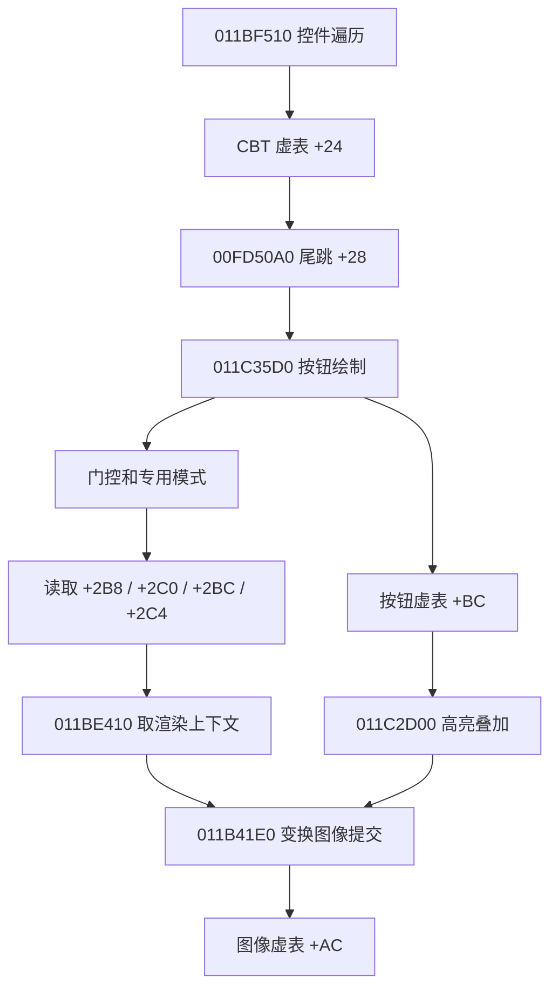

# 1031 CBT 配置、选组与按钮绘制调用链

后续revision6已将本文确认的原生组号、主图分支和独立高亮接入“配置预览”，见[本轮交付](../REVISION6.md)。下述“本轮”指此前静态恢复阶段；没有新增CBT业务hook，运行组号/数字IMG映射/输入和实机对照仍未知。

本轮离线恢复了本包全部 **8 个 CBT、24 个配置组**，并从客户端的加密标签、配置读取器、记录容器、选组函数追到了按钮选图和图像提交。原会话仍只观察到 4 个 CBT；8/8 是静态格式覆盖，不能写成运行覆盖。未重新启动客户端、运行采集器或更换 DLL。

这份文档补充 A01 / R06。早期 [cbt-native-evidence.json](cbt-native-evidence.json) 保存当时尚未解密标签的结果；标签、字段映射和绘制消费者以本报告及 [cbt-chain-evidence.json](cbt-chain-evidence.json) 的新增证据为准。运行状态、所有窗口和全部交互仍未验收。

## 版本、来源与可重建入口

| 对象 | SHA256 |
| --- | --- |
| 1031 EXE | `246b838163fa7c71aa0445fa4aafde04e7ac72aa72855a4b2a7eaeed5eeae264` |
| Script.pvf | `ca756b7103a91628cffdf42fb745e9185fd5937deb229289a74831aa30500e1f` |
| 只读内存基线 | `ab950286ad291236086beae21ef75b1732d4cd5e52db482e261f4c548969ea44` |

地址均为 VA，基线起点 `00400000`；转 RVA 应减去此值。快照含 0725.dll / stringtable.dll 的运行环境，不能称为无插件原始 EXE。所有结论限于上述 1031，未从另一版客户端移植地址。

- [机器证据](cbt-chain-evidence.json)：6 个解码字面量、13 处指令守卫、18 个直接 call、6 个虚表槽、20 段代码窗口；包含全部 CBT 原始字节、token、组、字段顺序、偏移和哈希。
- [离线检查](cbt-chain-verification.json)：114 项检查，包含真实字节、边界、缺失/嵌套分组、错误类型、重复字段、未知字段和主图分支。
- [native_strings.py](../../tools/native_strings.py)：有界离线字面量解码，不执行客户端函数。
- [cbt_schema.py](../../tools/cbt_schema.py)：类型专用解析、按原生组号选择、主图分支参考实现。
- [analyze_cbt_chain.py](../../tools/analyze_cbt_chain.py) / [verify_cbt_chain.py](../../tools/verify_cbt_chain.py)：重新生成证据并检查。工作区根目录依次运行 `D:\ProgramData\anaconda3\python.exe -X utf8 -B ui_lab_1031\tools\analyze_cbt_chain.py` 与同目录的 `verify_cbt_chain.py`。它们不加载 DLL、不调用游戏业务函数。

## 标签解密及与 PVF 的交叉核对

`0119FEF0` 检查首 WORD；若为 `2CA1`，UTF16 文本位于地址 +4；否则以字符宽度 2 调用 `0119FDA0`。离线只复现有界解码部分，未复现锁、缓存、分配器。

加密头的 `salt = header[1] & FE`，UTF16 单元数为 `((salt << 7) | salt) XOR u16le(header+2)`，字节数为单元数乘 2。初始 key 为 `salt OR 9A714CA0`。`0119F560` 每 DWORD 计算 `plain = cipher XOR key`，再令 `key = key * 1003F + plain`，按 32 位截断；不足 DWORD 的尾字节使用 key 的低字节异或，递推常数改为 `107`。结果必须有 UTF16 末尾零。

| 字面量地址 | 实际解码结果 | 用途 |
| --- | --- | --- |
| `0182B0EC` | `[CHANGEABLE BUTTON]` | 配置组 |
| `0182B0CC` | `[img index]` | 数字资源索引 |
| `01571C30` | `[img path]` | 显式 IMG 路径 |
| `0182B0A4` | `[button index]` | 顺序读取四个整数 |
| `0182B078` | `[highlight index]` | 独立高亮帧 |
| `01562178` | 空字符串 | 无显式路径的比较哨兵 |

上述标签已与 8 个实际 CBT 的 token 核对。往返校验只说明实现内部一致；指令证据、已知密文和实际标签匹配共同支撑解释。解码器限长并核对快照哈希，不扫描或导出无关字符串。

## 配置与记录结构

PVF 外层开始/结束标签是 type 5；内部 `[img path]` 等命令是 type 7。不能把内部命令升级成通用顶层段。整数为 type 2，IMG 路径为 type 7 字符串。保留大小写、原字符串 ID、字段顺序、重复字段和每个原始五字节 token；检索时才正规化路径。

`0100FEF0` 构造派生按钮，先调用基类 `011C3F30`，再在 `0100FF24` 写入虚表 `0182B8F4`，初始化记录容器和路径，调用 `01003770(path, deferred)`。正常 `01003770` 是 thiscall、`ret 8`；第二参数非零时先保存路径和占位记录，暂不解析文件。`010032B0` 是使用已保存路径的后续读取入口，其外部调用者的重置策略仍须继续核对，不能自行假设每次读取都清空容器。

两个读取器都经 `01223620` 进入既有 PVF 解析链。完整路径关系见 [资源跟踪协议](../../docs/RESOURCE-TRACE.md)。本轮关注的是解析后的类型消费，不改变原有 parser span 与 buffer span 的配对方式。

| 记录内偏移 | 字段 | 原生默认值 | 消费者 |
| --- | --- | --- | --- |
| `+00` | `[img index]` | 0 | 无显式路径时，`011BB1B0` 的参数 |
| `+04,+08,+0C,+10` | `[button index]` 四个输入值 | `0,0,0,-1` | 按原顺序传入虚表 `+B0` |
| `+14` | `[highlight index]` | -1 | 虚表 `+B0` 的第六个栈参数 |
| `+18` 起 | `[img path]` 的原生字符串对象 | 空 | 路径管理器；字符串对象含迭代器代理 |

`01002DA0` 的复制代码和 `010031F0` 的容器追加支持该布局；`01003299` 的 `add [edi+8],38h` 证明记录步长 56 字节。这里只公开被读写证据支持的字段，未把末尾剩余字节解释成新属性。

`01003770` 在读取文件组之前，通过 `01002E80` 初始化一条默认记录并在 `01003819` 追加。因此文件中的第一个组对应 **原生组号 1**；N 段文件组对应 1…N。第 0 条是占位记录，选组函数明确拒绝 0；不能把组号 0 当成“恢复原图”。

字段可重复，解析器保留全部字段及最后一次赋值的结果。遇到未知字段时保留原始内容并将 `schema_complete=false`；参考选择函数拒绝静默应用该组。此行为是外部工具的保守策略，不表示原生客户端会作同样拒绝。

## 选组、资源查找和帧指针写入

`01002C40(group)` 的 ECX 是按钮，栈上传组号，`ret 4`。它拒绝 0，并以容器 `+3C8/+3CC` 和步长 56 校验范围。记录地址为 `begin + group*56`。

1. `[img path]` 非空：使用全局管理器 `[01B564E4]` 的虚表 `+10`，传入 UTF16 路径，取得 IMG pack。
2. 路径为空：把 `[img index]` 传给 `[01A6A870]` 上的 `011BB1B0`。本包 `ui/expertjob.cbt` 第一组的数值是 16；管理器中 16 对应哪个列表/资源尚未闭合，不将它猜成 IMG 帧号。
3. pack 为空时失败返回。成功取得 pack 后有 `007B9840(pack,3)` 调用，其参数 3 的具体枚举语义尚未恢复。
4. 调按钮虚表 `+08`，实际为 `011C2CF0`，清理按钮初始化状态和图像指针；再调用虚表 `+B0`，实际为 `011C2CA0(pack,i0,i1,i2,i3,highlight)`。
5. 在按钮 `+3D8` 写入请求组号，返回 AL=1。这个返回不能证明窗口显示或 GPU 成功出图；选组代码也未把下层返回码原样交给调用者。

`011C2CA0` 再调用虚表 `+AC = 011C4AC0`；后者通过既有 `011B4BD0(pack,frame)` 查出各图像对象。**输入顺序与对象中的地址顺序不同：**

| CBT 输入 | 按钮内图像指针 | 选图读取分支 |
| --- | --- | --- |
| 第 1 个 `i0` | `+2B8` | 默认主图 |
| 第 2 个 `i1` | `+2C0` | active / forced ID 分支 |
| 第 3 个 `i2` | `+2BC` | active ID 且输入值为 1 的分支 |
| 第 4 个 `i3` | `+2C4` | `+0D=0` 分支；i3=-1 时不查帧 |
| 独立 `highlight` | `+2C8` | 后置高亮绘制 |

`011B4BD0` 使用 pack `+58/+5C`、每项 16 字节的帧表；已有 DLL 的查图/绘图观察点可捕获其中一部分。`-1` 不是有效帧号：高亮包装器仍会把它传给 lookup，应保留实际返回与后续门控。该 lookup 的错误/缺省分支会调用其他 helper，当前不能断言始终返回空指针；外部解码器不能把 -1 强行取模成最后一帧。

## 从按钮状态到绘制提交



`00FD50A0` 只有 7 字节：读取虚表后尾跳 `+28`，最终目标为 `011C35D0`。不能把这里按普通无控制流前缀直接复制进跳板。该地址本轮仅作静态证据。

对 `011C35D0` 的普通主图分支，可以使用以下顺序；[cbt_schema.image_branch](../../tools/cbt_schema.py) 返回零基输入槽和指针偏移：

```text
button[0C] == 0                  -> 跳过
u32(button[34C]) != 0            -> 专用分支 011C3180，本参考函数不选普通主图
button[0D] == 0                  -> i3 / +2C4
active_id == button[34] 且 input == 1 -> i2 / +2BC
active_id == button[34] 或 forced_id == button[34] -> i1 / +2C0
否则                            -> i0 / +2B8

active_id 来自 [01A424F0]
input 来自 [01B5650C]，读取 helper 为 011C7E20
forced_id 来自 [01A42500]
```

条件依次来自 `011BE0F0`、`011BE020`、`011BE2B0`。这些证据确定了选图优先级；尚未沿输入分发确认全局量写入时机，因此保留原始分支名，不把 `active_or_forced` 一律等同鼠标悬停，也不宣称所有键盘/焦点分支已恢复。

普通分支还使用各自的 alpha 与位置偏移：默认为 `+35C/+36C/+37C`，active/forced 为 `+360/+370/+380`，input=1 为 `+364/+374/+384`，禁用分支为 `+368/+378/+388`。最终 x/y 取按钮 `+14/+18` 加相应偏移；缩放还读取 `+38C/+390`。`+354` 和 `+358` 可导致先画默认底图、调整绘制状态、再叠加状态图；不能把整段绘制简化成永远只画一张帧。

`011BE410` 本身只返回 `[01B57168]` 中的渲染上下文，没有在该函数内完成坐标变换。随后 `011B41E0` 执行颜色通道转换、特殊中心参数处理，再调图像对象虚表 `+AC`。后者到延迟 packet/GPU 的所有权仍属 R08，不能靠调用时间邻近补出。

高亮与主图分开：`011C2CA0` 将 highlight 查出的图像写到 `+2C8`；主绘制尾部调用 `+BC = 011C2D00`。该函数还检查 `011BE250` 返回的 `button[0F]` 和高亮指针，随后计算 alpha 并再次提交变换图像。`[highlight index]` 是可叠加资源，不应塞进四个状态帧中的某一格。另有 `+394/+39C` 控制的附加图层，仍须独立处理。

本轮已解释为什么仅解析四帧或按连续指针顺序播放会丢失部分状态、错选图片或漏掉叠加层。这是已定位的复刻缺口，**现有外部预览器尚未接入本模块，不能据此宣布全部错位已修复。** 原生裁剪、父坐标与 IMG 裁剪原点、字体、专用模式和同帧层序还须继续核对。

## 全部实际 CBT

| PVF 成员 | 文件组数 | 资源特点 |
| --- | ---: | --- |
| `ui/compounditem.cbt` | 2 | `Interface/commonBtn01.img`；四帧各不相同 |
| `ui/expertjob.cbt` | 2 | 第一组数字 img index=16；第二组显式路径 |
| `ui/expertjob/skillrequest.cbt` | 1 | `Interface2/popup/popups02.img`；86,87,88,86 |
| `ui/expertjob/skillusing.cbt` | 1 | 同 pack；89,90,91,89 |
| `ui/powerwar/joinorsecedepower.cbt` | 2 | `Interface/popup02.img`；92…97 |
| `ui/powerwar/joinorsecedepowerwar.cbt` | 2 | 同 pack；125…130 |
| `ui/powerwar/winningstreakicon.cbt` | 6 | `Interface/MainHUD.img`；每组四值相同，组间为 107…112 |
| `ui/pvp/channel/channelbutton.cbt` | 8 | `Interface/newstyle/windows/PvP_Channel_list.img`；各组 highlight=7，第四帧独立 |

24 个组都只使用上述已识别字段。机器证据还保留目录中 9 处显式 `.ui` 控件→CBT 引用，来自 PVP 两个 buttons UI 和 testbutton；这是静态引用下限，不表示其余 CBT 没有硬编码创建或其他消费路径。

## 后续 DLL 观测与仍待完成项

本轮不改动部署的 revision 5。下一阶段可据本链设计有界观测，但这些位置尚不是已部署、已通过实机的 hook：

| 观察位置 | 必须保存的关系 | 需要解决的问题 |
| --- | --- | --- |
| `01003770` / `010032B0` | 按钮实例、CBT 路径、deferred、读取成功/失败 | 延迟加载、容器代次、重新读取是否累积 |
| `01002C40` 入口/出口 | 同线程调用 span、按钮、请求组号、前后 `+3D8`、返回值 | 业务代码实际何时选哪组 |
| `011C2CA0` / `011C4AC0` | 同按钮的 pack、四帧、高亮、查图对象；限定 CBT 虚表 | 避免把基类按钮的结构泛化到全部控件 |
| `011C35D0` 与既有图像事件 | 同遍历/实例/帧的原始分支量、主图和叠加图 | 状态与绘制对应，不能只按最近资源日志关联 |

优先继续离线追输入全局量写入、数字 img index 的管理器来源、专用模式和布局分支；补丁设计还需入口指令搬移、调用约定、尾跳/异常路径、字节守卫、限频与停止恢复检查。新观测应优先记录状态变化或短段采样，控制开销，不恢复全量每帧日志。

等这些入口与缺口准备好后再安排短时代表性 UI 验证。当前无需重新采集、逐窗开关或再打一轮副本。A01 只将“格式与主图消费者”推进到离线已恢复；实际交互、全部 UI、完整 GPU 重放继续保留为未完成。
