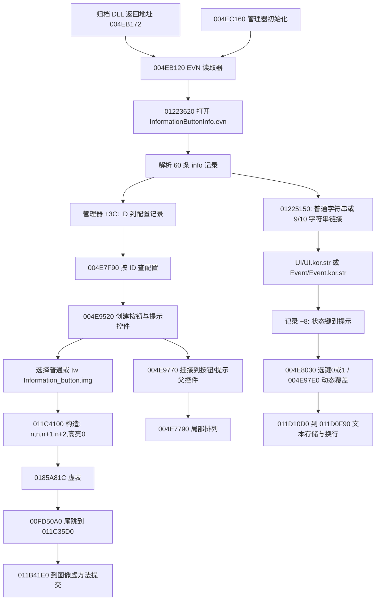

# 1031 EVN 事件按钮、资源使用与 EXE 调用链

后续revision6已接入60条记录单选、状态帧、提示来源及明确标示意的配置总览，见[本轮交付](../REVISION6.md)。本文保留静态恢复阶段的证据和限制；没有新增EVN业务hook，真实可见列表、业务条件和客户端画面对照仍未验。

更新：2026-10-18。适用对象是本工作区的 1031 `DNF.exe`，与其他版本的技能研究独立。本文从已归档 DLL 调用栈定位磁盘 EXE，恢复 EVN 的读取、按钮构造、状态提示和局部布局。**已恢复的是这类 HUD 事件按钮的共用逻辑；全部业务触发、所有 UI 和最终像素回放仍有缺项。**

## 证据和重建入口

| 来源 | 指纹 / 结果 |
| --- | --- |
| DNF.exe SHA256 | `246b838163fa7c71aa0445fa4aafde04e7ac72aa72855a4b2a7eaeed5eeae264` |
| Script.pvf SHA256 | `ca756b7103a91628cffdf42fb745e9185fd5937deb229289a74831aa30500e1f` |
| 只读内存快照 SHA256 | `ab950286ad291236086beae21ef75b1732d4cd5e52db482e261f4c548969ea44` |
| 已归档真实会话 | `20261018T071256-61396`，实际使用 revision 3 |
| DLL 记录到的 EVN 读取返回地址 | `004EB172`，前一条 `004EB16D CALL 01223620` |
| EVN 成员 | `ui/event/informationbuttoninfo.evn`，2,802 字节，560 个 token，60 条记录 |
| EVN 成员 SHA256 | `94df406040d323300712dd3606a68b41dfcd3259f1e9a2dbf7b19886ad4307af` |

本轮验证了 **16 段 EVN/按钮/文字/坐标代码、此前 20 段 CBT 代码、13 个原生字面量**，这些选定范围的磁盘 EXE 与内存快照逐字节相同。报告保存每段 VA、RVA、磁盘偏移、长度和两端 SHA256。没有把局部一致推广为整个内存映像一致；原快照仍含 `0725.dll` 和 `stringtable.dll` 的运行环境。

机器证据：[evn-chain-evidence.json](evn-chain-evidence.json)。193 项离线检查：[evn-chain-verification.json](evn-chain-verification.json)。完整记录表：[evn-records.csv](evn-records.csv)，保留全部 60 条 ID、图片、四帧、高亮和状态提示。CSV 的空提示须结合 `has_tooltip` 判断，不能将缺少提示解释为有意清空。

可调用实现：[evn_schema.py](../../tools/evn_schema.py)；证据生成：[analyze_evn_chain.py](../../tools/analyze_evn_chain.py)；核验：[verify_evn_chain.py](../../tools/verify_evn_chain.py)；磁盘 VA 映射：[exe_image.py](../../tools/exe_image.py)。这些工具只读 EXE/PVF/历史日志，在独立报告目录写结果，不调用游戏函数。

```powershell
& 'D:\ProgramData\anaconda3\python.exe' -X utf8 -B ui_lab_1031/tools/analyze_evn_chain.py
& 'D:\ProgramData\anaconda3\python.exe' -X utf8 -B ui_lab_1031/tools/verify_evn_chain.py
```

`ExeImage` 先核对 EXE SHA256，再解析 x86 PE32 的节表；VA 不能直接当磁盘偏移。它拒绝跨节、越界、超长、零填充内存和没有唯一文件映射的读取。

## 完整主链和资源边界



DLL 栈还记录了 `004EC195`，与 `004EC190 CALL 004EB120` 的返回位置相符。它能证明文件走过这条读取路径；这次历史采集没有专门记录每条事件 ID 的实际创建、显示和状态变化，不能把 60 条配置当作 60 个已显示窗口。

上述最后的图像提交复用 [CBT 调用链](1031-CBT配置与绘制调用链.md)。包解码、纹理上传、延迟提交与 GPU 所有权未在本轮闭合；报告中的图像调用不是 GPU 画面已经完整复刻的证明。

## EVN 文件和字符串链接

字段作用由 `004EB120` 原生分支核对，原始字节仍通过 token 序列可逆重建。不要只用早期通用 `fields` 展平数组解释重复标签。

| 字段 | 文件形式 | 原生作用 |
| --- | --- | --- |
| `[info] ... [/info]` | type 5 标签 | 一条配置记录，原生分配 `0x40` 字节 |
| `[id]` | type 5 标签 + type 2 整数 | 写记录 `+0`，默认 `-1`，作为配置查找键 |
| `[imageStartIndex]` | type 5 标签 + type 2 整数 | 写记录 `+4`，默认 `0`；后续由按钮构造函数消费 |
| `[tooltip]` | type 5 标签 + type 7 状态名 + 文本 | 状态键和文本写入记录 `+8` 的关联容器 |

文本有两种原生读取路径，见 [01225150 反汇编](../ui-layout-code/evn-exe-01225150.asm)：type 7 是直接字符串；type 9 后接 type 10 则是字符串表 ID 与键。`0122519D` 调用 `012C98D0` 查表，再写入输出宽字符串。本文件的 50 条提示全部使用链接形式，其中：

- 48 条来自 list ID `20` → `UI/UI.kor.str`。
- 2 条来自 list ID `23` → `Event/Event.kor.str`，对应事件 ID `300`、`307`。

例如事件 ID `0` 的提示使用键 `info_tooltip_enable_000`。重制器需要保留原始 list ID、键、STR 路径和解析后文字；不能用键名当显示文本，也不能把两个 STR 固定合并为一个。STR 按严格 CP936 解码，路径原文保留，查找时统一斜杠与大小写。

源文件部分文字含字面反斜杠与 `n`。解析器不执行 Python/JSON 式转义，不擅自把它变成 LF；原生 `011D0F90` 还会按字体宽度插入换行。完整转义/字体呈现规则仍待继续追踪，展示层应明确区分原文和呈现处理。

`004EB5F0..004EB694` 的模式映射如下：

| 模式文字 | 原生 byte key | 本文件数量 |
| --- | --- | --- |
| `disable` | 0 | 2 |
| `enable`，以及所有未匹配 disable/timer 的名字 | 1，原生默认 | enable 共 48 |
| `timer` | 2 | 0；EXE 支持此分支 |

有 2 条记录包含两个 `[tooltip]`，分别保存 key 0 和 key 1；这些是状态提示，不能去重成一个字段。当前 60 条 ID 全部唯一。`decode_evn()` 保留字段顺序、重复项、原始 token 和未知字段；最终有效状态映射另存，便于后续调用。缺失字段保持原生默认值，未解析的链接会报错，未知字段使该记录 `schema_complete=false`。

## 原生对象和按钮创建

配置记录和运行按钮是不同对象，不能互换偏移：

| 对象 | 已证实成员 |
| --- | --- |
| 配置记录，分配 `0x40` | `+0` ID；`+4` 起始帧；`+8` 状态提示关联容器；`+18` 被消费者作为提示项数量检查。其余初始化成员不在本文泛化命名 |
| 管理器 | `+3C` 配置查找容器；`+4` 运行记录容器；`+B0` 初始化传入的父控件；`+B4/+B8/+BC` 初始化创建的关联父控件 |
| 运行记录，分配 `0x0C` | `+0` 按钮；`+4` 提示控件；`+8` 排列参与标志，创建时初始化为 1，不能单独证明已挂接；`+9` 是否有配置提示 |
| 通用按钮，分配 `0x3C4` | 构造器 `011C4100` 设置虚表 `0185A81C`；四帧指针 `+2B8/+2C0/+2BC/+2C4`；高亮 `+2C8` |

`004EB75E` 把 ID 与配置指针放到管理器 `+3C`。`004E7F90(id)` 从该容器返回配置，找不到则返回空。`004E9520(id)` 先找已有运行记录，存在就复用；否则查配置再创建按钮和提示对象。运行记录随后插入管理器 `+4`。不要在每帧读到一个资源路径时重新生成按钮实例。

原生图片选择见 [004E9520](../ui-layout-code/evn-exe-004e9520.asm)：

```python
id16 = event_id & 0xffff
if id16 < 100 and id16 != 24:
    image = "Interface2/HUD/Information_button/Information_button.img"
else:
    image = "Interface2/HUD/Information_button/Information_button_tw.img"

n = info.imageStartIndex
button = Button(image_pack, n, n, n + 1, n + 2, highlight=0)
```

这里 `id` 与图片帧不是同一个编号；也不能按文件顺序代替事件 ID。`24` 有特殊路径，且 `004E9770` 的普通挂接包装器还会跳过它，不能忽略此例外。

这段机器码先把 `0,n+2,n+1,n,n` 压栈，再临时压入图片路径调用全局图包管理器虚方法 `+10`。图包返回值随后压栈，在 `004E95EF` 或 `004E9645` 调用 `011C4100`。**前面预先压入的帧参数保留给按钮构造器**，不能误认为它们都是图包路径查询的参数。构造器最后 `ret 0x18`，消耗 pack、四帧、高亮共六个参数。

构造器调用按钮虚方法 `+AC = 011C4AC0`，把四个输入帧转换成图像指针，再单独查询高亮帧。映射如下：

| 输入 | 帧号 | 按钮图像指针偏移 |
| --- | --- | --- |
| 0 | `n` | `+2B8` |
| 1 | `n` | `+2C0` |
| 2 | `n+1` | `+2BC` |
| 3 | `n+2` | `+2C4` |
| 高亮 | `0` | `+2C8` |

这说明按钮有四个状态输入槽，但当前 EVN 用三个连续的状态帧；前两个输入共用 `n`。帧 0 的高亮是独立图层，是否绘制还受按钮 `+0F` 等条件控制。`004E965A` 调用 `011BE360(1)`，后者写 `+0F=1`，因此重制时只画主图可能漏掉高亮。

## NPK 和相关 ANI/ACT 的实际关联

两套 IMG 在 `DNF1031客户端/ImagePacks2/sprite_interface2_hud_information_button.NPK`。包大小 445,709 字节，SHA256：

`73161b49baf430c6c14c36b340b152c1167d35bb3e3726248e67b1ab2330467d`

| NPK 成员 | 偏移 | 字节数 | IMG 版本 / 帧数 |
| --- | --- | --- | --- |
| `sprite/interface2/hud/information_button/information_button.img` | 580 | 175,033 | v2 / 289 |
| `sprite/interface2/hud/information_button/information_button_tw.img` | 175,613 | 270,096 | v2 / 496 |

本轮重新核对包哈希、两项成员字节 SHA256，以及 60 条配置派生帧号均在对应 IMG 帧表范围内。帧数来自封存的静态 IMG 索引解析；这不等于每帧像素、链接帧和原生显示状态已做实机比对。客户端路径与包内路径通过添加 `sprite/`、统一斜杠及大小写关联，不要把 `Interface2` 当 PVF 内部 IMG 文件。

`004EC160` 还解密并传给 `0109A4E0` 两条 ANI 路径：

- `UI/Event/CommonAni/infomation_new.ani`，110 字节，静态解析 3 帧。
- `UI/Event/CommonAni/infomation_complete.ani`，110 字节，静态解析 3 帧。

`infomation` 是资源的实际拼写，不能“纠正”为 information。同名 ACT 若存在，机器证据会单独列在 `resources.related_acts`；**目前没有把同名 ACT 推定为该构造器直接读取的资源**。ANI 进入两个动画对象的原生关联已恢复，动画对象如何附着到具体事件按钮、时钟和每帧资源提交仍是待完成项。

## 绘制状态、文字更新和布局

通用按钮虚表 `0185A81C` 与 CBT 虚表在以下槽上指向同一实现：`+24→00FD50A0`，`+28→011C35D0`，`+AC→011C4AC0`，`+BC→011C2D00`。主图规则可直接复用 CBT 的 `image_branch()`：

1. 按钮 `+0C=0` 跳过；`+34C!=0` 走另一路径，尚未完整解释。
2. `+0D=0` 选择第 3 输入，即 `n+2`。
3. active ID 等于控件 ID 且全局输入值等于 1，选择第 2 输入，即 `n+1`。
4. active 或 forced ID 等于控件 ID，选择第 1 输入，即 `n`。
5. 其余选择第 0 输入，即 `n`。高亮、其他覆盖图层随后独立处理。

这里保留原始分支条件；全局 active/input 的所有写入和通用鼠标事件命名尚未闭合，不将其固定命名为全部控件通用的 hover/pressed 行为。

`004E8030(id, enabled)` 调用按钮虚表 `+18` 更新启用状态，并将 `enabled!=0` 归一化为提示 key 1，否则 key 0；找到相应配置提示后调用 `011D10D0(text)`。缺少该 key 时跳过更新，不能擅自回退为另一个提示。构造时另有遍历首个提示项初始化的分支；其容器顺序与随后显式选状态应分别保留。

`004E97E0(id, text, state)` 还提供动态文字和 state=2 的通知路径，既可能更新提示，也可能创建额外提示记录。实际状态文字会受到业务调用参数覆盖，因此仅靠 EVN 静态文本不能解释全部运行文字。`011D10D0` 是一个尾跳包装器，取提示控件 `+2B8` 的负载指针后转到 `011D0F90`；它不是普通“复制若干前导指令后返回”的安全 hook 入口。后者保存文字并按字体宽度处理换行，字体测量/最终字形绘制仍待继续分析。

`004E9770` 把按钮挂到管理器 `+B4`，把提示挂到 `+B8`，然后调用 `004E7790` 排列。此排列沿当前运行容器的遍历顺序，只给 `+8!=0` 且有按钮的记录递增序号 `k`；是否已挂接仍应另查父链或实际挂接调用。对非负序号：

```python
q, r = divmod(k, 12)
x = 280 + 20 * r
y = 530 - 20 * q
```

依据是 `004E7812..004E7848` 的有符号除法乘数 `0x2AAAAAAB`、高位右移 1 和后续坐标运算。按钮坐标送入 `011BEAD0(x,y,1)`；提示位置随后按按钮坐标和尺寸重新计算。原生坐标更新函数会写控件 `+14/+18`，并在指定条件下递归移动子控件。上述坐标属于该原生分支的局部 HUD 布局，尚未证明适用于所有分辨率/根坐标模式；不能覆盖其他窗口的 PVF 布局。

## 重制器如何调用

独立演示器可按下面顺序使用这批结果。实际实现应调用资源解码器和渲染器的接口，本文 VA 只用于核对原客户端。

```python
from evn_schema import decode_evn, button_spec
from cbt_schema import image_branch

decoded = decode_evn(strict_pvf_decoder.script("ui/event/informationbuttoninfo.evn"))
config_by_id = {g["effective"]["id"]: g for g in decoded["groups"]}

record = config_by_id[event_id]
if not record["schema_complete"]:
    raise ValueError("EVN has unknown fields")
info = record["effective"]
spec = button_spec(event_id, info["image_start_index"])
pack = image_resources.open("sprite/" + spec["path"].replace("\\", "/").lower())

# 映射输入槽，不按指针地址的排序决定状态帧。
button_images = [pack.frame(i) for i in spec["input_frames"]]
highlight_image = pack.frame(spec["highlight_frame"])

# 由重制器的业务状态显式请求创建/显示/启用；静态资源读取不触发业务。
tooltip_key = "1" if enabled else "0"
if tooltip_key in info["tooltips"]:
    tooltip_text = info["tooltips"][tooltip_key]

# image_branch() 接收已恢复的原始按钮状态字段；渲染器另处理高亮、坐标、颜色与裁剪。
```

默认值、两套图包分支、帧映射和状态提示已形成可调用参考。演示器需要保留事件 ID→业务适配层、原生坐标模式、文本呈现和动画时钟的独立接口，避免用一套未经验证的猜测补全全部窗口。

## 后续 DLL 观察设计和未完成项

本轮没有修改、编译或部署 DLL，也没有请求重录。revision 5 仍是已部署、待新实机验收的采集版本。后续专用观察点已经可缩小到：

| 观察位置 | 要记录的最小内容 | 目的 |
| --- | --- | --- |
| `004E9520` 入口/正常出口 | manager、ID、返回运行记录，以及有限读取的按钮/提示指针 | 把配置 ID 和真实按钮实例连起来 |
| `004E9770` 入口/出口 | ID、挂接前后 `+8`、两个父控件 | 验证出现/重新挂接，保留特殊 ID24 边界 |
| `004E8030` | ID、启用参数、是否找到提示键 | 解释 `n+2` 与 disable 提示何时实际出现 |
| `004E97E0` | ID、state、已知 EVN/通知控件的有限文本 | 解释动态提示与 state2；不读取任意 editbox 内容 |
| `004E7790` 出口 | 当前参与排列记录、坐标、父链 | 验证本轮局部排列与真实画面坐标关系 |
| 通用图像/ANI 消费点 | pack/frame、动画实例、明确父调用栈 | 补齐通知动画的资源和绘制归属 |

每个候选仍须按实际入口字节、调用约定、完整指令边界、尾跳/相对跳转和退出路径设计 hook；反汇编窗口本身不能直接当补丁长度。当前 DLL 的通用图片调用可以提供部分帧证据，专用事件观察能补 ID/状态/实例的直接关联。只记录生命周期变化和有界快照，继续采用滚动日志，避免再次用长时间全量采集放大卡顿。

尚未闭合：全部 60 个事件的业务谓词/点击处理、ID24 专用显示路径、隐藏销毁与地址重用、通知 ANI 的时间与图层、字体与转义、特殊按钮模式、根坐标/裁剪、延迟 packet 到 GPU 的完整归属。同一文件被读取、配置被创建、实际控件可见和最终像素一致应分别验收；下次实机测试只需针对新增专用入口做短时验证。

本轮使用本地 [dnf-pvf-reference 技能](C:/Users/16908/.codex/skills/dnf-pvf-reference/SKILL.md)的版本、编码与来源保留要求；EVN 结构和地址结论来自本工作区 EXE/PVF/归档 DLL 证据。
