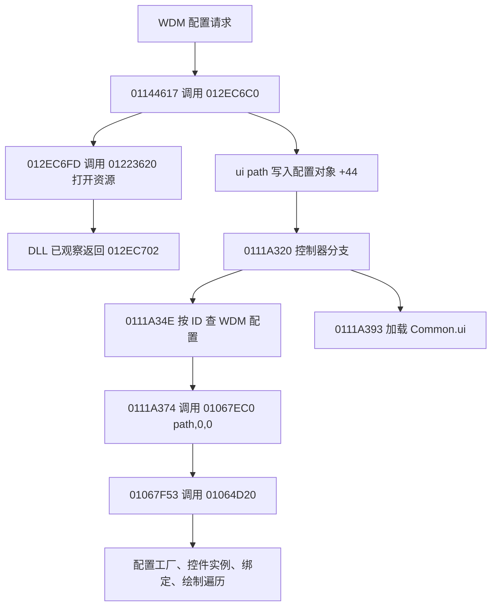

# 1031 STM / WDM 地图界面原生调用链

后续revision6已接入区域/Common独立实例、STM主图/追加帧、原始列与ID索引，见[本轮交付](../REVISION6.md)。下述增量指此前静态恢复阶段，未增加地图业务hook；状态消费者、两条缺图和实机画面对照仍待完成。

更新日期：2026-10-18。本增量继续使用已封存 DLL 会话做离线逆向，**总体研究尚未完成，也没有增加或部署新的 DLL hook**。这次已恢复 WDM 配置进入 UI 加载器的直接代码链、STM 的嵌套记录结构和一个实际消费者；MAP 场景绘制、MM 投影、专用控件与最终像素仍有缺口。

## 版本、原始数据与验证

| 来源 | 身份与边界 |
| --- | --- |
| 1031 磁盘 `DNF.exe` | SHA256 `246b838163fa7c71aa0445fa4aafde04e7ac72aa72855a4b2a7eaeed5eeae264`；PE32 x86，基址 `00400000` |
| `Script.pvf` | SHA256 `ca756b7103a91628cffdf42fb745e9185fd5937deb229289a74831aa30500e1f` |
| 只读内存快照 | SHA256 `ab950286ad291236086beae21ef75b1732d4cd5e52db482e261f4c548969ea44`；含既有插件环境，不能称为无插件原版 |
| 已有 DLL 会话 | `20261018T071256-61396`，revision 3；WDM 返回 `012EC702`，STM 返回 `0131484B` |
| 本次代码核验 | 14 段选定代码、22 个原生字面量逐字节与磁盘 EXE 比对一致；只对选定范围成立 |
| 本次资源核验 | 26 WDM + 1 STM；关联 27 UI + 6 ACT；核对 35 个物理 IMG 候选及对应 NPK 哈希，另保留 2 个未定位路径 |
| 离线检查 | [239 项检查全部通过](spatial-chain-verification.json)。结构、字节、资源来源检查不等于原生显示或输入验收 |

[机器证据](spatial-chain-evidence.json)保存每个代码窗口的 VA、RVA、文件偏移、字节哈希、反汇编路径；每个资源保留原始 token、偏移、顺序、原始字节和来源哈希。[26 条 WDM→UI 映射 CSV](wdm-ui-resources.csv)可直接用于后续工具建立资源关系。[分析工具](../../tools/analyze_spatial_chain.py)只读客户端和既有归档，不改封存清单。

本地注释样例的用途是辅助区分场景地图与 UI 控件。以下具体对象偏移、记录宽度及调用地址来自当前 1031；DFQ 的 Lua 地图实现不能作为这些原生细节的证据。

## WDM：文件如何进入 UI 加载器



`011445E3` 分配 `0xD0` 字节的 WDM 配置，调用构造器 `011375C0`，再于 `01144617` 调用 `012EC6C0(destination,path)`。这是两个栈参数的读取器，调用方清栈；返回 AL。`012EC6FD` 的直接 CALL 目标是 `01223620`，恰好返回到 DLL 已记录的 `012EC702`，从而将真实文件请求与静态函数连接起来。

读取器在打开成功后调用 `01137510` 复位部分字段与容器。不能假设这一复位函数会重写对象全部字段；例如本段没有确认它清空 `+44` 的 UI 路径。复现工具的空字符串初始化属于自身数据模型，不应据此描述原生重读行为。

| WDM 配置偏移 | 已确认内容 | 原生证据 |
| --- | --- | --- |
| `+00` | 结束处写入列表/资源查找结果；具体业务名称尚不命名 | `012ECB5E` 后写入 |
| `+04` | `[name]` 字符串对象 | `012EC7B4→01225150` |
| `+24` | `[map image]` IMG 路径字符串对象 | `012EC7F9→01225150` |
| `+44` | `[ui path]` 字符串对象 | `012EC847→01225150` |
| `+64` | `[map image]` 后的整数帧参数 | `012EC803` 读取、`012EC80B` 写入 |
| `+68` | `[dungeon]` 条目容器，每项三个 DWORD | `012EC899` 清容器、`012EC93C` 追加 |
| `+7C` | `[hell dungeon]` 整数归一化为布尔 | `012EC97D–012EC985` |
| `+80` | `[hell quest]` 整数容器 | `012EC9CB` 追加 |
| `+94` | `[hell freepass item]` 双整数记录容器 | `012ECA39` 追加 |
| `+A8` | `[item condition]` 处理结果容器 | `012ECA9A` 追加，另有未解释读取，见下文 |
| `+BC` | `[minimap points]` 双整数记录容器 | `012ECB2F` 追加；本批 26 个资源未使用该标签 |

`0111A320` 的非零参数分支从控制器 `+29C` 取查找 ID，以全局 `01A6F6DC` 指向的管理器为 ECX 调用 `01135B50`。返回配置和控制器 `+3B0` 非空时，读取配置 `+44` 的字符串：容量位于对象 `+5C`；容量 `<8` 时文本在 `+48` 内联，否则 `+48` 保存文本指针。不能把 `+44` 自身直接当 UTF16 指针。

`0111A374` 调用 `01067EC0`，ECX 为控制器 `+3B0` 的 UI 加载器，栈参数是该路径、0、0。随后 `0111A393` 向另一个加载器 `controller+3B4` 加载原生字面量 `WorldMap/UI/Common/Common.ui`。因此区域 UI 和公共 UI 要保留两个加载实例及父子上下文，不能只根据一个 WDM 文件名合并成一张图片。

该函数的零参数分支会调用公共 UI 的虚方法，并对区域加载器调用 `01064970`。它证明了特定控制器存在加载/清理分支；尚不能把此入口推广成所有窗口的通用 show/hide 协议。WDM 在预加载或枚举过程中被读到，也不证明该区域 UI 已显示。

## WDM 的嵌套标记与实际资源

`[dungeon]` 不是简单平铺的二元数组。读取器先读一个整数，随后 `012258F0` 可以返回紧随的标签或数值；若标签为 `[in progress]`，将第三个 DWORD 置 1，再读关联整数。`012EC8C5` 为第二列设默认 -1，第三列默认 0。完整条目如下：

```text
DWORD +0 = dungeon_id
DWORD +4 = condition_value       // 具体业务条件尚未完整恢复
DWORD +8 = in_progress_marker    // 配置标记 0/1，不代表本次玩家实际完成状态
```

26 个 WDM 中共 216 条记录、100 个 `[in progress]` 标记。按每个 type-5 标签都切成独立顶层字段的通用视图，会在该标记处切断地下城记录。新 [结构解码器](../../tools/spatial_schema.py)按作用域处理，同时保留完整原始 token；它没有改写旧通用查看器或外部预览。

`[item condition]` 还有一处必须保留的不确定性：`012ECA74` 读取并保存一个整数，`012ECA7D` 再读一个整数但不保存；循环尾 `012ECAA3/012ECAAC` 重复类似操作。本批数据中有单整数列表，尚需解释整数读取器遇到标签时的游标规则和业务消费者。因此新数据只记录原整数列表及该原生行为，不把它强行命名成“物品 ID/数量”二元组。

`worldmap/lorien.wdm` 的实际关联是：

```text
[map image] WorldMap/Lorien.img 0
[ui path]   WorldMap/UI/Lorien.ui
[dungeon]   (1,-1), (2,-1), (1500,428), (1501,4340)
```

对应 UI 包含以下不同控件与资源：

| 控件 | 配置位置/参数 | 资源与边界 |
| --- | --- | --- |
| `IDC_WORLDMAP_BACKGROUND` | `(0,0)`，普通 image | `WorldMap/Lorien.img`，帧参数 0 |
| 地狱/练习/扩展模式背景 | `(0,0)`，各自 image 配置 | 分别引用 SelectDungeonHell / DungeonExercise 的 IMG，关联 `Action/background_event.act` |
| 四个地下城 balloon | `(478,331)`、`(367,211)`、`(172,465)`、`(522,376)` | `WorldMap/selectdungeon02.img`；整数参数带不同地下城 ID，需要 balloon 类型专用实现 |
| `IDC_WORLDMAP_SWITCHBOX` | `(400,100)`，switchbox | 同 IMG，有 16 个整数参数；不能把所有整数当帧号或统一位移 |

本批 27 UI 的明确 ACT 引用都有现存 PVF 候选。相对 `Action/worldmap_balloon.act` 对应的实际成员是 `worldmap/ui/action/worldmap_balloon.act`，**大小仅 2 字节，只有脚本头、没有 token 或行为**。不能因为多个 balloon 引用了它，就推断这里定义了动画或点击逻辑；原生专用控件和业务逻辑仍可能实现这些行为。

其余 ACT 为 `background_event.act` 及 Common 下的 `expandbutton.act`、`keyboardguidebanner.act`、`mapselectbanner.act`、`properchannelbanner.act`。机器证据保留所有实际字节/字段；当前只核对静态引用，ACT 的实例、触发时钟和渲染消费者还未闭合。相对路径解析保留所有存在候选，没有据此断言原生搜索优先级。

## STM：五整数槽位与四整数关卡

`01144E52` 分配 `0x60` 字节的 STM 配置，调用 `01142F10` 构造，再由 `01144E83→01314800(destination,path)` 读取。`01314846→01223620` 返回到已捕获的 `0131484B`。打开成功后 `01314870→01142E90` 复位，字段如下。

| STM 配置偏移 | 内容 |
| --- | --- |
| `+00` | 文件处理结束时写入的资源查找结果，业务名称暂留 |
| `+04` | 顶层 `[dungeon]` 整数，默认 0；实际这一成员未声明 |
| `+08` | 主地图帧整数，默认 0 |
| `+0C` | `[name]` 字符串对象 |
| `+2C` | `[map image]` 路径字符串对象 |
| `+4C` | area 容器；底层 begin/end 在对象 `+50/+54`，area 步长 `0x50` |

| area 内偏移（步长 `0x50`） | 内容 |
| --- | --- |
| `+00` | `[area]` 整数 ID |
| `+04` | `[slot image]` 路径字符串对象 |
| `+24` | `[slot type]` 容器，记录为五个 DWORD / 20 字节 |
| `+38` | district 容器，district 步长 `0x3C` |
| `+4C` | `[survival]` 的单个整数，默认 0 |

| district 内偏移（步长 `0x3C`） | 内容 |
| --- | --- |
| `+00` | `[district]` 整数 ID |
| `+04` | stage 容器；begin/end 在 district `+08/+0C`，记录步长 `0x10` |
| `+18` | `[append image]` 路径字符串对象 |
| `+38` | append image 的整数帧参数 |

**更正早期“槽位四元组”的待确认描述：`[slot type]` 每项五个整数，`[stage]` 每项四个整数。** 原生 `01314C2D–01314C45` 连续初始化五个 -1，随后五次有效整数读取，`01314D60–01314D79` 复制 20 字节。`01314E37/58/6E/98` 则保存四列 stage 值，形成 16 字节记录。

实际 `stagemap/advancealtar.stm`：

```text
main IMG: Interface/AdvanceAltar/selectStage/AdvanceAltar_map01.img, frame 0
area 0:
  slot IMG: Interface/AdvanceAltar/selectStage/AdvanceAltar_Stage.img
  slot type rows: [0,5,6,7,2], [1,8,9,10,3]
  district 1: append main IMG frame 1; stage IDs 3511..3514
  district 2: append main IMG frame 2; stage IDs 3515..3518
  district 3: append main IMG frame 3; stage IDs 3519..3522
  survival: 3523
```

例如 stage 3511 的四列为 `[3511,97,398,0]`。第一列作为 stage ID 的使用已有下述消费者证据；中间两列与坐标外观相符、末列与槽位 key 相符，但本轮尚未沿实际选图/布局消费者完成核验。因此参考代码保留为四列数组，不提前将其标成已确认的 `x/y/type`；slot type 后四列也不直接命名为通用 normal/hover/pressed/disabled。

原生读取还有三个会影响重建的数据规则：

1. slot type 以首列查询；若 key 已存在，读取器不会用新五列覆盖旧项。原始重复记录仍必须保留用于审计。
2. `[district]` 会重置当前 district 的 ID、stage 容器及 append 内容；`[stage]` 块处理完后，`01314EE3→01314420` 才把当前 district 追加到 area。不能按看到 append image 就直接提交。
3. `[/area]` 经 `01314F59→01314740` 追加整个 area；该函数将尾指针增加 `0x50`。district 追加尾指针增加 `0x3C`。不能将这些容器当连续 DWORD 数组扫描。

## STM 已追到的消费者与 IMG 来源

真实调用栈的 `0057E166` 前一条 CALL 为 `0057E161→01135B50`，ECX 为全局 `01A6F70C` 指向的管理器，入参 1。返回配置存入控制器 `+2E4`，紧接着 `0057E16E→00575EA0` 建立 stage 索引。

`00575EA0` 按 area `0x50`、district `0x3C`、stage `0x10` 步长遍历，对每个 stage 的第一列查找/建立控制器 `+2E8` 容器项，保存 area ID、district ID 和在 district 内从 1 开始的序号。序号每遇到一个 stage 即增加；该调用没有把 stage 的末列当数组序号。`+2E8` 是带迭代器/节点结构的容器，不是可直接按 ID 乘步长访问的表。

实际图像资源来自 `ImagePacks2/sprite_interface_advancealtar_selectstage.NPK`：

| 物理成员 | 帧描述符数量 | 本次核对 |
| --- | ---: | --- |
| `sprite/interface/advancealtar/selectstage/advancealtar_map01.img` | 4 | 主帧 0、append 帧 1/2/3 均在范围内 |
| `sprite/interface/advancealtar/selectstage/advancealtar_stage.img` | 37 | 已保存物理位置、长度和哈希；五整数列的全部运行时状态含义尚未确认 |

每个 IMG 的具体 offset、size、hash、version 和所属 NPK 哈希都在机器证据 `resources`，可按物理位置读取。没有重新验收这些图片的像素/alpha/播放，也没有把静态帧数量当作状态机已经闭合。

## 与通用绘制栈衔接时的约束

WDM 动态路径进入 `01067EC0` 后，沿已记录的通用链路执行：`01064D20` token 解析 → `01074B70` 类型配置工厂 → 实例初始化 → `010669F0` 绑定观察点 → `011BF510` 控件遍历 → 虚表 `+24` 类型绘制 → `011B3950` / `011B41E0` 图像请求。详见 [原生契约](../../docs/NATIVE-CONTRACT.md)与 [CBT 类型消费者](1031-CBT配置与绘制调用链.md)。

这能为外部工具建立 WDM→区域 UI→具体控件→IMG 的资源上下文，但 balloon/switchbox、ACT、父级坐标、文字、裁剪和延迟 packet 仍须各自证据。场景 MAP 的相机/视差不能直接加到屏幕 UI 坐标上；WDM 也不是 MAP 世界图层本身。本次没有恢复 MM 的 real/project rect 投影公式。

35 个物理 IMG 候选之外，以下两个引用在封存 NPK 成员清单中没有同路径成员：

- `sprite/worldmap/selectdungeon02_cn.img`
- `sprite/worldmap/timegate.img`

保留它们是为了明确缺图原因；不能自动替换成同名近似资源。清单里存在其他目录的 timegate 和 `sprite/worldmap/selectdungeon02.img`，尚无原生重定向证据证明它们可代换。下一步需要沿资源路径变换/实际归档读取核对。此发现补入未完成项，不修改原封存资源审计结论。

## 后续工具如何调用与验证

```python
from spatial_schema import decode_stm, decode_wdm
# script 必须是 StrictDecoder 对当前哈希 PVF 得到的原始结构。
stage_config = decode_stm(script_stm)
world_config = decode_wdm(script_wdm)
# fields/source_tokens 始终保留原数据。
# schema_complete 仅表示结构被本解码器识别；semantic_complete 仍为 False。
```

`scripts[*].decoded` 可直接供后续技能/窗口演示器读取；不要调用本 EXE 的裸 VA 来初始化外部程序，也不要把本参考解码器当成完整地图窗口渲染实现。已知结构允许演示器正确保存 area/district、选取主/append 资源并构建 stage ID 索引；未知状态列在实际消费者确认前需要明确显示缺项。

复核命令（在工作区根目录执行）：

```powershell
& 'D:\ProgramData\anaconda3\python.exe' -X utf8 -B ui_lab_1031\tools\analyze_spatial_chain.py
& 'D:\ProgramData\anaconda3\python.exe' -X utf8 -B ui_lab_1031\tools\verify_spatial_chain.py
```

离线验证包括五/四列宽度差异、嵌套 in-progress、重复 key、重复 dungeon 清容器、原 token 不变、截断/作用域错误拒绝、完整源字节重建、代码 CALL 目标和 NPK 物理哈希。

后续 DLL 的候选观察点为 `012EC6C0`、`01314800` 的入/出参和 `0111A320` 的 WDM ID/加载器关联；应只记录有界元数据。通用 UI loader、资源 buffer 与绑定事件已能覆盖部分路径，先利用已有入口的实例/线程/span 关联，再评估是否需要增加专用补丁。上述候选尚未完成运行前守卫、并发/异常退出和停止恢复验证，不能直接套复制字节 hook 或安排用户重新长时间采集。

下一轮继续离线追 STM 槽位后四列、stage 坐标/末列的专用绘制消费者，以及 WDM balloon/switchbox 和两条未定位 IMG。整体未完成列表见 [未完成清单与补采计划](../1031-未完成清单与补采计划.md)。
