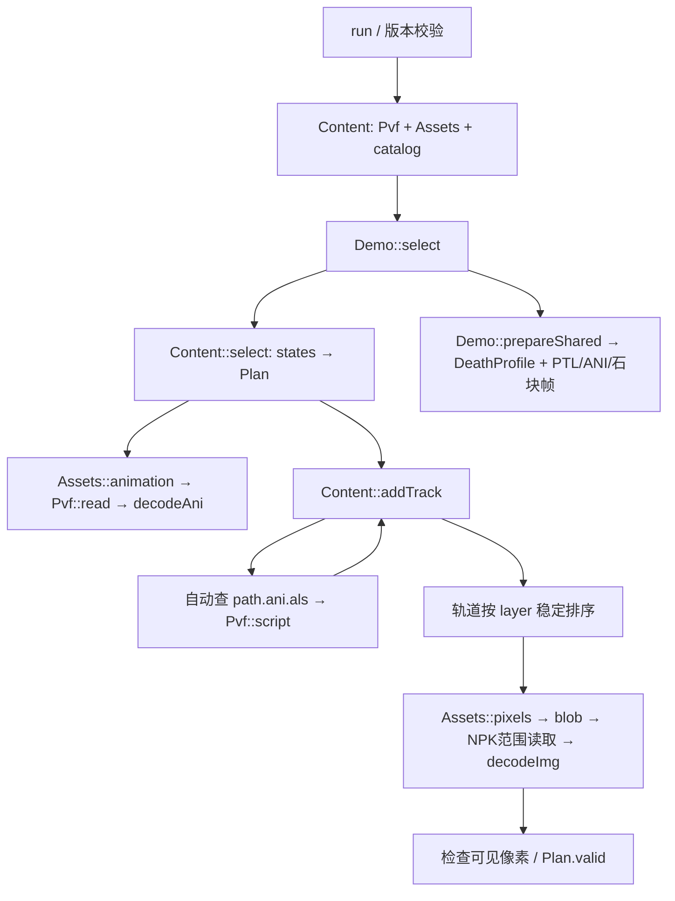
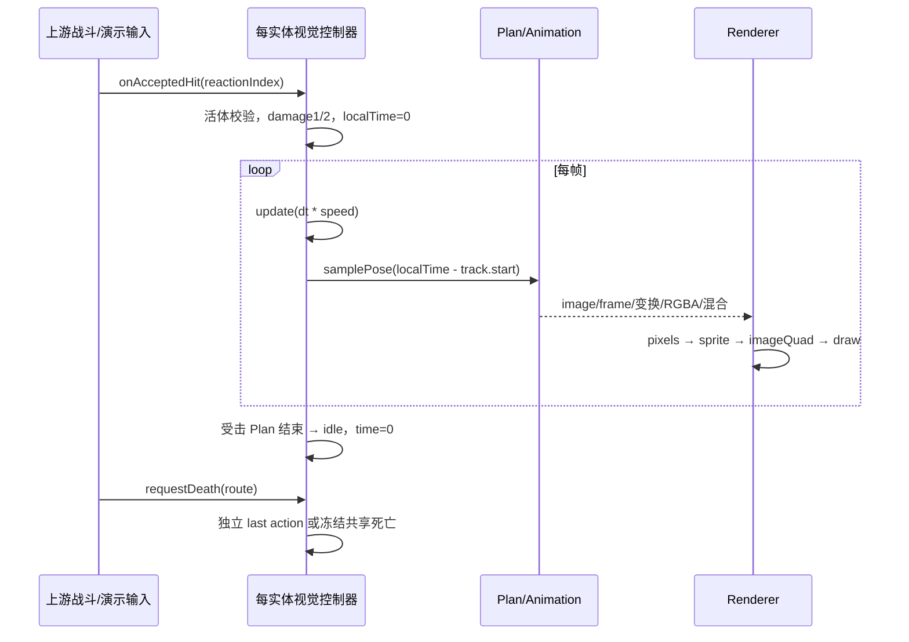
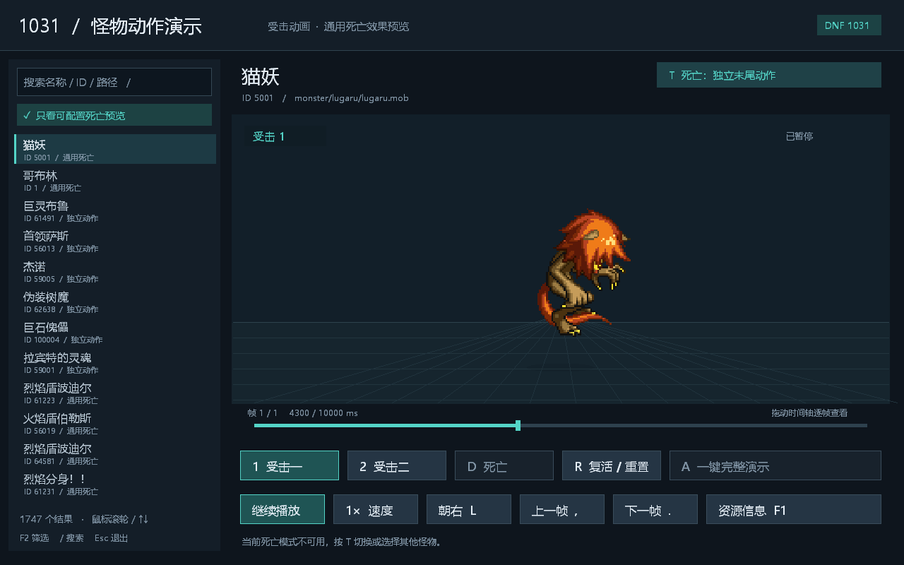
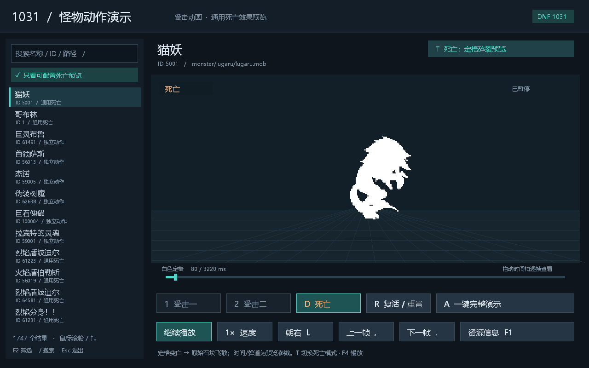
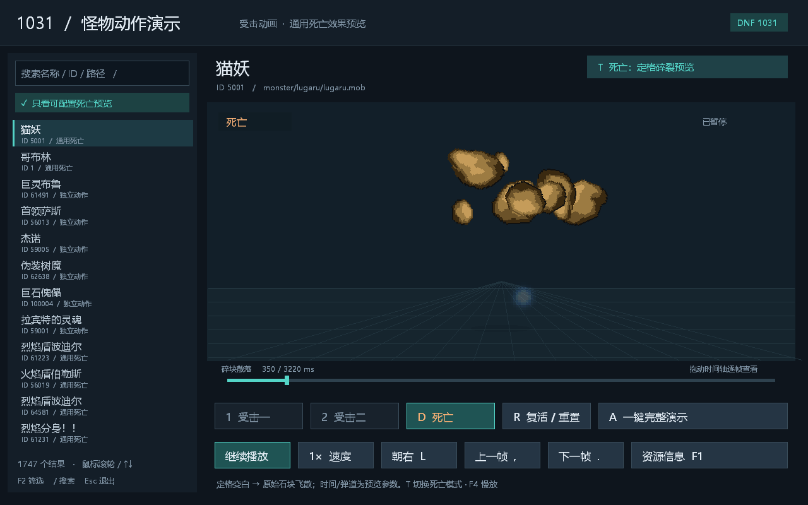

# DNF1031 怪物受击与死亡效果完整实现交接

版本：`dnf1031-accepted-effects-20261018-v1`。目标是让技能演示器对任意 MOB 使用同一套初始化与播放流程，复现已验收 demo 中的受击动作、独立死亡动作，以及“当前姿态定格 → 白色轮廓 → 原始石块崩飞 → 身体消失”的效果。本包提供完整参考源码、2070 个 MOB 的绑定、机器配置、资源查询与导出工具、原生调用证据和验收图片。

**完成标准是复现这版已认可的视觉效果。** 原生代码尚未恢复的分级分支、HP 到死亡的完整决策、精确原版延迟及移除顺序均有标注；它们不会被本文的重建参数冒充。支持全部 MOB 的数据驱动接入，不代表 2070 个定义均已逐一播放验收，也不代表特殊 ACT 脚本全部执行。

## 1. 开始接入与交付物

给接手开发者或自动编码代理的顺序：先读本节和第 3、10 节，读取 [effect-contract.json](effect-contract.json) 与 [data/monsters.json](data/monsters.json)，按第 4～9 节移植；源码是精确行为参考，实际入口行号见 [CODE_MAP.md](CODE_MAP.md)。使用第 2 节工具获取目标怪物的完整资源图，最后执行第 12 节验收。不得用单个猫妖或哥布林的硬编码代替 MOB 绑定。

| 文件 | 用途 |
| --- | --- |
| [effect-contract.json](effect-contract.json) | 路由、状态、时钟、粒子、omit 位、功能范围的机器配置 |
| [data/monsters.json](data/monsters.json) | 全部 2070 个 MOB 的版本、ID、名称、来源哈希、状态入口与轨道 |
| [RESOURCE_MAP.md](RESOURCE_MAP.md) | 通用死亡 23 个 ANI/PTL、29 套碎块图、代表怪物完整路径索引 |
| [source/src/main.cpp](source/src/main.cpp) | Plan 编译、ALS 实例、SDL 绘制、受击/死亡控制器与验证入口 |
| [source/src/resources.cpp](source/src/resources.cpp) | PVF/NPK 读取、脚本、ANI、IMG 像素与姿态采样实现 |
| [source/include/dnf/resources.hpp](source/include/dnf/resources.hpp) | 资源/ANI/图像/缓存接口及类型 |
| [source/include/dnf/geometry.hpp](source/include/dnf/geometry.hpp) | 统一坐标与四顶点变换 |
| [source/include/dnf/shared_death.hpp](source/include/dnf/shared_death.hpp) | DeathProfile、种子、石块生成及解析弹道 |
| [tools/query_effects.py](tools/query_effects.py) | 按任意 MOB ID/路径查询 PVF→ANI/ALS→NPK，并可导出原始成员 |
| [tools/build_reference.py](tools/build_reference.py) | 仅依赖本包与 LLVM-MinGW 构建相同参考实现 |
| [tools/verify_package.py](tools/verify_package.py) | 校验包内哈希、文档链接、代码位置、六个资源图和可选渲染验证 |
| [examples/summary.json](examples/summary.json) | 六个不同怪物的依赖图入口；每个 graph 含原字段/原帧/图片索引 |
| [evidence/runtime/verification.json](evidence/runtime/verification.json) | 六个动画案例的状态、时长、轨道及实际渲染记录 |
| [evidence/runtime/shared-death-verification.json](evidence/runtime/shared-death-verification.json) | 四个共享死亡案例及冻结、配置和时间轴检查 |
| [EVIDENCE.md](EVIDENCE.md) | 1031 内存调用链、字段、官方样例证据与未知边界 |
| [manifest.json](manifest.json) | 每个交付文件大小和 SHA256，来源 EXE/PVF 哈希 |

包内保留全部本实现源码与构建所需 SDL2/zlib/json/stb 头文件、链接库和运行 DLL；LLVM-MinGW 编译器及原始游戏客户端另行提供。游戏 IMG/ANI/PTL 的全量二进制继续来自本地 1031，使用下面的查询导出命令可取得选定怪物资源闭包。许可见 [THIRD_PARTY.md](THIRD_PARTY.md)。`source/tools/` 保存原 demo 的生成/验收脚本供溯源；独立使用本包时执行 `tools/` 的三个入口。

## 2. 固定版本、资源获取与构建

仅绑定以下原始客户端，不能混入其他客户端版本：

| 对象 | SHA256 |
| --- | --- |
| `DNF.exe` | `246b838163fa7c71aa0445fa4aafde04e7ac72aa72855a4b2a7eaeed5eeae264` |
| `Script.pvf` | `ca756b7103a91628cffdf42fb745e9185fd5937deb229289a74831aa30500e1f` |
| 已验收原 demo EXE | `0bd9e2ea2a90fef861b19a50ad98c3351e31e47506054fb23bc3e3853c54906f` |

以下 PowerShell 命令在**本包根目录**执行，Python 需 3.11+，查询/打包检查工具只用标准库。将 `$client1031` 改为实际资源目录；该目录应直接包含 `DNF.exe`、`Script.pvf`、`ImagePacks2`。

```powershell
$client1031 = 'D:\game\DNF1031客户端-20260708\DNF1031客户端'
python -X utf8 -B .\tools\verify_package.py
python -X utf8 -B .\tools\query_effects.py --client $client1031 --id 5001 --out .\build\cat-resources --extract
# 可改用 --path 'monster/act8/chiefsars/chiefsars.mob'；ID 与路径二选一。
python -X utf8 -B .\tools\build_reference.py --toolchain 'D:\dnf-rebuild\dnf-native-demo\third_party\llvm-mingw-20261006-ucrt-x86_64\bin'
& '.\build\monster_demo.exe' --client $client1031 --id 5001
# 集成完成后：实际解码、受击、独立死亡、共享死亡及生命周期验证。
python -X utf8 -B .\tools\verify_package.py --client $client1031 --run-reference
```

查询结果 `graph.json` 的 `monster` 是目录原绑定；`nodes` 保存每个资源的 SHA256、PVF 成员偏移或 NPK 包名/成员偏移/长度；`edges` 标出字段偏移、ANI 帧和 IMG 帧、编译轨道或脚本引用。ANI 节点包含全部帧、原始属性、时长和图像绑定；IMG 节点包含所需帧的裁切/整幅尺寸、编码和 link 结果。`--extract` 另外生成 `resources/pvf/<逻辑路径>`（解密且去填充）与 `resources/npk/<成员路径>`（原始成员）。这些可送入本包 `decodeAni/decodeImg`；导出的脚本仍是二进制 token，文本字段在 graph 中。

查询也保留攻击/行为等未执行资源的引用，资源图可能比实际绘制路径大。`script_reference_unexecuted_unless_supported` 仅表示资源关系；`common_death_inventory_not_all_executed` 包含分级变体供查阅。图中诊断必须查看：不存在、歧义、解析器不支持等均不能当成“已成功加载”。它不执行 NUT/OBJ/ACT 行为中的动态资源生成；实际使用的完整视觉闭包由编译轨道、递归 ALS、所选共享效果及最终运行 `resource-reads.json` 共同确定。

## 3. 数据契约与怪物初始化

MOB 作为资源身份，`monster/monster.lst` 的 ID 作为查找入口；多个 ID 可指向同一 MOB。先用 `ids` 查找唯一目录行，缺失/多匹配应报错，不能默认哥布林。无列表 ID 的定义可按精确 MOB 路径初始化。

`data/monsters.json` 顶层包含 `schema_version/source/default_id/monsters/scope`。每个怪物包含：

| 字段 | 含义/处理 |
| --- | --- |
| `path`, `sha256` | 原 MOB 规范路径及解密后成员内容 SHA256 |
| `ids`, `name` | 列表 ID 集合、显示名；不用于视觉规则分支 |
| `die_effect` | `[die effect]` 原始字段列表，保留重复和无效情况，不先压成默认值 |
| `states.<key>.source/source_offset/binding_tag` | 状态绑定所在 MOB、字段字节偏移与标签 |
| `entry`, `kind` | 唯一资源入口；kind 为 `motion`（ANI）或 `action`（ACT） |
| `tracks[]` | 归一后的基础/子 ANI 实例描述，不包含后续递归生成的 ALS 实例 |
| `issues`, `unexecuted_tags`, `action_sha256` | 配置问题、未执行 ACT 标签及 ACT 成员哈希 |

每个 track 为 `{path,start_frame,layer,x,y,role,source,source_offset}`：`start_frame` 是**基础 ANI 的帧序号**，不是毫秒；`role` 为 `base/sub`；`source_offset` 指向引用发生处。初始化使用已编译的绝对逻辑路径，保留同路径的多个 track，不能按 ANI 路径合并动画实例。

状态优先级：

| 视觉状态 | 按顺序寻找的明确配置 |
| --- | --- |
| idle | `[waiting motion]` → `[waiting action]` → `[basic action]` |
| damage1 | `[damage motion 1]` → `[damage action 1]` |
| damage2 | `[damage motion 2]` → `[damage action 2]` |
| down | `[down motion]` → `[down action]` |
| death（独立） | 仅 `[last action]` |

优先字段一旦提供 ANI/ACT 值即绑定它；若该字段存在但歧义/无效，保留诊断，不能跳到后面的标签掩盖错误。完全无可识别资源值的字段不会形成状态入口。不要从文件名包含 `die` 推断死亡，不要把 `overturn` 当死亡。静态可建立轨道的数量：idle 2066、damage1 1880、damage2 1831、down 1492、death 357；1,637 个 MOB 有 `[die effect]`，仍需运行时校验可解码/可见。

从原始脚本重新编译目录时，参考 [prepare_content.py](source/tools/prepare_content.py)：每个引用必须有唯一候选并实际存在。普查处理的候选是“相对引用脚本目录 / 原路径 / `monster/` 根下路径”规范化后去重，保留全部存在项，有歧义就失败。运行期 ALS 按父 ANI 目录解析。路径将 `\` 改成 `/`、ASCII 转小写、消解 `.`/`..`；CP936/GBK 字符串转 UTF-8 后用 `std::filesystem::u8path`，不能用窄字符系统路径破坏中文目录。ANI 图片名作为图像逻辑路径，不再相对 ANI 拼接。

建议初始化顺序：验证版本 → 取目录行 → 加载 PVF 与 NPK 索引 → 编译各状态 Plan → 遍历轨道所有唯一 `(IMG,frame)` 解码检查 → 准备共享死亡配置与依赖 → 建立每个实体自己的状态时钟。图像全 alpha=0 的整套 Plan 标记不可见占位，不能让 UI 显示“播放成功”。某些帧透明属于源资源合法数据，按原索引保留。

## 4. 完整加载与代码调用链

以下均是本包**可执行参考实现**的调用链；原生内存链另见第 11 节。



PVF：`Pvf::Pvf → header/tree 解密 → 成员索引 → stringtable.bin/n_string.lst`；`Pvf::read → checksum 解密 → 去填充`；`Pvf::script` 将 2 字节头后 5 字节 token 解析成保留 offset 的 fields，并处理字符串链接。`Assets::Assets` 按排序后的 NPK 文件建立成员多值索引；读取时先匹配规范原名，再尝试 `sprite/` 前缀，多个成员没有显式选择时抛歧义错误，不根据碰巧的扫描顺序覆盖。

ACT 只编译 `[MOTION]`：要求正好一个 `[BASE ANI]`；`[SUB ANI]` 按 `(path,parentStartFrame,layer)` 三元组；`[SUB ANI WITH XY]` 按 `(path,parentStartFrame,layer,x,y)` 五元组。用基础 ANI 帧时长计算 `start_ms = Σ duration[0..start_frame-1]`。引用负帧或超出基础帧数应报错。ACT 的其他执行段不属于本视觉播放器，保留标签和完整 graph 字段供上层使用。

Plan/Track：

```text
Plan  = {key, entry, kind, error, base, tracks[], duration, issues}
Track = {shared Animation, start_ms, end_ms, x, y, layer, hold, role}
```

基础轨道 `hold=true`，非循环播放超出 ANI 时间时保留末姿态；子 ANI/ALS 为 `hold=false`，在 `time >= end_ms` 后不画。Plan 时长取基础 ANI 总时长及全部轨道结束时间的最大值。子 ANI 可以使独立死亡计划比基础动作更长。按 layer 稳定升序绘制；相同层保留输入/展开顺序。

ALS：自动读取 `<ANI完整路径>.als`，例如 `.../die.ani.als`。`[use animation] (path,name)` 建立名称；`[add]/[remove] (parentFrame,layer,name)` 在父 ANI 的帧边界发生。每次 add 创建实例，起点为父 track 起点加其本地帧边界；同名下一个事件（包括再次 add）结束前一实例；remove 的 layer 不用于匹配。子实例的 layer 加父 layer，偏移继承父 track，结束时间裁切到父 track 结束。先按父帧稳定排序事件。相同 ANI 可因不同 name/事件有多个时钟；缓存 Animation 不等于缓存实例。循环引用用递归栈检测，深度不超过 12、单 Plan 轨道实例不超过 256。父结束裁切、时钟重置及基础层 hold 是本演示器的实现策略。

## 5. 受击播放链、时钟和独立死亡



参考入口：`Demo::command/event → start("damage1"/"damage2") → step → draw → Canvas::plan → Animation::samplePose → Canvas::sprite → Assets::pixels → decodeImg → imageQuad → SDL_RenderGeometry`。键盘 `1/H` 对应 damage1、`2` 对应 damage2，`D` 死亡、`R` reset。键盘是演示输入；技能演示器改为战斗系统的已确认事件。

非致死受击进入对应 Plan，从 0 播一次，完成后 idle 从 0 循环。重复受击在本 demo 会重启对应动作；真实连击打断/硬直/霸体由上游明确决策。reactionIndex 仅允许 0/1，对应 damage1/2；不可把任意攻击类型整数直接当数组索引。没有该状态资源时返回诊断并保持原状态；不得无提示用另一受击动作覆盖。

所有动画时间是毫秒，速度只作用一次。idle 在 Plan.duration 上取模；非循环在 `[0,duration]` 截断。`Animation::frameAt/samplePose` 在累计时长首次大于时间的帧采样；到总时长取末帧。默认每帧 50ms，显式节点 12 覆盖全局节点 12，负时长失败；0ms 帧可存在且在正常时间采样中越过，逐帧调试仍可访问。damage 完成回 idle；down 完成保持末姿态，未实现倒地恢复物理。

独立死亡路由从 `[last action]` 对应 Plan 的 0ms 开始，基础/子 ANI/ALS 照原层次播放。结束后保持死亡状态及基础末姿态，已结束子层不再显示。具体的尸体移除、掉落和复活由上游控制，不能把“末帧 hold”当作原客户端的对象移除规则。ACT 若含被动对象生成或脚本，仅 ANI 组合不足以还原这些行为；本包会保留未执行信息。

自动路由：有明确且可播放 death→独立；有 death 字段但资源无效/透明→诊断；没有该状态字段→尝试有效共享配置。强制独立仍只找 last action；强制共享仍保留 MOB omit 位。此为可替换的预览策略，原生两类死亡效果是否组合、何时叠加、评级如何影响还未恢复，不应固定为原版通则。

## 6. ANI/IMG 采样与渲染约定

完整二进制布局和所有像素格式分支已随 [resources.cpp](source/src/resources.cpp) 交付，移植时保留边界校验、link 循环检查及未知节点错误。ANI 先读帧数和图片名、全局属性，再读各帧盒体、image index/IMG frame、x/y、属性。盒体原值可保存，但不能由它们的存在宣称本模块完成命中判定。

| ANI 节点 | 本实现消费方式 |
| --- | --- |
| 7 | x/y 浮点缩放 |
| 8 | 旋转弧度；仅提交 SDL 时转角度 |
| 9 | RGBA，默认 `[255,255,255,255]` |
| 10 | 当前帧到下一帧的位置、缩放、旋转、RGBA 插值开关 |
| 11 | 解析图形 effect；本预览将 1/2 作加色，其余普通混合。5 的 RGB、6 的 position 有解析但未在 Canvas 中应用 |
| 12 | int32 帧时长（ms），默认 50 |
| 24 | 本预览按 bit1 水平/bit2 垂直翻转，转成有符号缩放 |

这是当前解码器的预览解释，不是对全部原生枚举的最终鉴定。每帧有效属性 = 全局默认叠加**当前帧**属性，不能继承前帧。仅连续量插值：不对 image/frame、blend、flip、盒体插值。旋转按作者的数值直接线性插值，保留完整旋转，不擅自走最短角。未知节点报错；已识别但未消费的非零节点 `1/3/18/25/26/27/28` 写到诊断。节点 16 音频等不执行。

IMG 支持本客户端解码器中的 legacy 与新版签名、版本 1/2/4；处理 17 link、14/15/16 像素和 18/19/20 DXT、raw/zlib/调色板分支。RGBA 输出包含裁切 `x/y/width/height` 与原画布 `logicalWidth/Height`。link 应使用最终目标的图像/裁切信息。透明占位必须通过解码后的 alpha 识别，不能只看图像宽高。

坐标采用屏幕式 `x` 向右、`y` 向下。ANI 偏移与 IMG crop 在同一个未裁切坐标系，必须先相加。对每个裁切顶点 `(u,v) ∈ {(0,0),(1,0),(1,1),(0,1)}`，`s` 为场景/实体公共缩放：

```text
X = (pose.x + crop.x + u*crop.w) * pose.scaleX * s
Y = (pose.y + crop.y + v*crop.h) * pose.scaleY * s
worldX = entityX + facing*track.x*s + facing*(X*cos(r) - Y*sin(r))
worldY = entityY + track.y*s              + X*sin(r) + Y*cos(r)
```

flip 已折入 pose.scale；facing 为 ±1，只在模型空间施加一次。UV 固定 0..1，负缩放通过四顶点几何表达，不向后端提交负宽高。不能对每张裁切帧重新居中，否则受击/死亡抖动。模型与白色轮廓使用相同坐标链；附层保持相同冻结时钟。demo 的 `(794,382)`、fit、offsetX/Y、clip 是窗口预览参数，技能演示器换成自己的世界锚点/镜头变换，粒子不要改变镜头自动取景。

纹理 RGBA 与采样颜色相乘，最终 `alpha = IMG.alpha * ANI.alpha/255 * lifecycleFade`；普通 straight-alpha BLEND 或当前预览 effect1/2 的 ADD。粒子辅助 `effectSprite` 以所选 IMG 裁切图片的中心绘制，使用自己的 x/y/size/angle 与朝向，不套用主体 ANI crop 偏移；若替换后端，按这条辅助绘制语义复现。

## 7. 共享死亡配置、资源链与冻结

调用链：`Demo::prepareShared → DeathProfile(row) → Pvf::script(MonsterDiePiece.ptl) → Assets::animation(各 ANI) → Canvas::sprite(调色图0..3)`；触发时 `Demo::start("death") → useShared → freeze → state=death,time=0`；绘制 `Demo::draw → sharedDraw → Canvas::plan(冻结) + effectSprite(碎块/flash/smoke)`。

配置必须是恰好一个三项整数 `[selector,palette,omit]`：selector 非负，palette 在 0..9999，omit 非负。负 selector/重复/畸形配置均拒绝自动猜测。selector 仅保留并检查，原生 rating/force 语义未确证。本实现：

```text
pieces = palette > 0 && !(omit & 1)
smoke  = !(omit & 4)
flash  = !(omit & 8)
blood  = 不执行；保留 omit&2 供完整实现
pieceImage = "monster/common/m%04d.img" % palette
```

位是**省略掩码**；原生效果对象使用取反后的启用掩码，不能把两者混用。强制共享模式也不取消 omit。palette0 不创建碎块。需要碎块时必须能解码选定图的 0..3 帧，否则共享计划不可用。烟雾/闪光使用原资源；资源缺失需诊断。

主要资源：

| 角色 | PVF/NPK 逻辑路径 | 消费方式 |
| --- | --- | --- |
| 碎块 PTL | `monster/common/particle/monsterdiepiece.ptl` | count、gravity、life、speed，引用下列 ANI |
| 碎块 ANI | `monster/common/animation/monsterdiepiece.ani` | 无固定图，采样其 alpha；图由 palette 动态注入 |
| 碎块图 | `sprite/monster/common/m0001.img`～`m0029.img` | 每套 4 帧；按 MOB palette 选择，不能始终用 m0001 |
| 闪光 ANI | `monster/common/animation/monsterdieflash.ani` | 采样 image/frame、scaleX、alpha |
| 闪光图 | `sprite/monster/common/monsterdieflash.img` | 中心绘制，加色 |
| 烟雾 PTL | `monster/common/particle/monsterdiesmoke.ptl` | 原生加载证据和字段保留；当前 demo 不完整执行其 PTL |
| 烟雾 ANI/图 | `monster/common/animation/monsterdiesmoke.ani`、`sprite/monster/common/monsterdiesmoke.img` | 校验 ANI 可读，实际按第 8 节近似布局图的第 0 帧 |

逐项哈希、原字段、分级变体及 NPK 定位见 [RESOURCE_MAP.md](RESOURCE_MAP.md)、[common-death-resources.json](evidence/common-death-resources.json)、[death-img-index.json](evidence/death-img-index.json) 与目标 `graph.json`；这些是完整资源说明的组成部分。[资源图集](images/death-resources.jpg) 展示原石块/通用图，不能用新画的通用石块替代原调色图。

死亡冻结必须在改 state/time 之前完成，记录 `{Plan引用快照,sourceTime,sourceLoop,frozenBounds,particles}`。冻结当前动作和全部活跃附层的**相同原时间**，不是回到 damage1/idle 第 0 帧。Plan 可以复制 track 列表并共享只读 Animation；其引用必须在死亡结束前存活。主体当时不存在有效 Plan 才回退 idle，其次 damage1；共享准备至少要求其中一个可见姿态。

`frozenBounds=[x,y,w,h]` 是当前各活动帧 crop 四顶点经过 ANI 变换后的模型空间并集，包含裁切图内透明边缘，并非精确非透明像素轮廓。按 facing=1、场景缩放=1 求边界，粒子初值在此空间生成，最终随实体朝向/缩放绘制。若没有有效矩形，参考实现退回待机取景中心附近 60×80 的框；集成时应记录此诊断。

白色纹理：从原 IMG RGBA 复制一份，将 RGB 全置 255，**保留每像素 alpha**；缓存键 `(版本,IMG,frame,white)` 与普通纹理分开。绘制时忽略原 ANI 的 RGB 着色，仍保留 ANI alpha、姿态、附层和生命周期 fade，强制普通 alpha 混合。不能在背景画白色矩形，也不能把透明洞填实。

## 8. 共享死亡精确时间线与公式

下面所有布局、时间线、随机分布和弹道是**用户已认可 demo 的重建参数**，原资源提供图片/帧/部分粒子字段；未宣称是原生硬编码常数。直接按下列值可复现当前效果，未来原生校准只替换策略。

| 死亡本地时间 | 主体与效果 |
| --- | --- |
| `0 ≤ t < 60ms` | 当前原色姿态冻结 |
| `60 ≤ t < 220ms` | 同一姿态白色轮廓，模型/附层不再推进 |
| `t ≥ 220ms` | 碎块、闪光、烟雾同时从 age=0 开始 |
| `220 ≤ t < 310ms` | 白色主体在 90ms 内线性淡出 |
| `t ≥ 310ms` | 主体不画；继续绘制生命期内的附加效果 |
| `t = 220 + life` | 本次死亡视觉完成，状态保持 dead；当前 life=3000，总长3220ms |

主体淡出 `fade = clamp(1 - (t-220)/90,0,1)`，仅在 fade>0 时绘制；白色开关为 `t>=60`。50ms 合成帧仅为 demo 效果时间轴步进，并非死亡原 ANI 帧率。普通动画仍用原时长。

碎块 PTL 的本版本字段：`maximum create number=10`、`gravity=1500`、`life time=3000`、`move variable 1=[400,400]`、`landing type=[stop]`、对象 `../Animation/MonsterDiePiece.ani`。当前实现取 move variable 第一个值为 speed=400；读取不到时默认 count10/gravity1500/life3000/speed400。gravity/life 必须>0，count在0..128；不把 speed 第二值误称为已恢复的角度规则。

**只在 freeze 时生成一次粒子列表**。随机种子为规范化 MOB 路径 UTF-8 字节的 FNV-1a32：初始 `2166136261`，逐字节 `seed=(seed XOR byte)*16777619`，每步 unsigned32 溢出。每次随机执行 xorshift32：

```text
seed ^= seed << 13
seed ^= seed >> 17
seed ^= seed << 5
U = (seed & 0x00ffffff) / 16777216.0
```

全部位运算限制32位，右移是无符号右移。设冻结并集中心 `(cx,cy)`、尺寸 `(w,h)`，每个粒子顺序消耗 **8 次** U：

```text
x0    = cx + (U1-.5)*w*.7
y0    = cy + (U2-.5)*h*.65
vx    = (2*U3-1)*speed*.6
vy    = -speed*(.55+U4*.55)
spin  = (2*U5-1)*270              # 度/秒
angle0= U6*360                    # 度
frame = floor(U7*4)               # IMG帧0..3
size  = .5+U8*.5
```

设 `seconds=(t-220)/1000`、`floor=y+h`、`g=gravity`：

```text
impact = (-vy + sqrt(vy*vy + 2*g*max(0,floor-y0))) / g
q      = clamp(seconds,0,impact)
x      = x0 + vx*q
y      = min(floor, y0 + vy*q + .5*g*q*q)
angle  = angle0 + spin*q
```

到地面时位置和旋转均停止。只有 `0≤age<life` 才绘制，颜色白 `[255,255,255]`，alpha取 `MonsterDiePiece.ani.samplePose(age,false).rgba[3]`。该 ANI 本身透明度可能提前归零，因此“PTL 活3000ms”不保证每个粒子整整可见3秒。不能每帧积分或重新随机，否则时间轴回看、暂停和朝向切换会改变结果。

闪光：当 `0≤age<flashANI.duration`，采样原 image/frame 和 alpha，位置为冻结并集中心，size=`max(.5,pose.scaleX)`，旋转0，加色；当前实现未消费该闪光 ANI 的其他平移/scaleY，需按当前辅助绘制结果接入。

烟雾：当 `0≤age<1500`，`k=age/1500`；使用 `monster/common/monsterdiesmoke.img` 第0帧，`x=cx`、`y=bottom-30*k`、size=`1.4+2.5*k`，RGB=`205,205,205`、alpha=`floor(55*(1-k))`，旋转0，加色。它是简化的烟雾扩散布局，并非完整烟雾 PTL 解释器。碎块/烟雾/闪光最终都走 `effectSprite`，叠加顺序为主体→碎块→闪光→烟雾。

多怪物场景为每个实体保存独立粒子列表及死亡时钟。本参考用 MOB 路径作种子，使同一模型的重复播放一致；可选的实例随机化属于后续产品策略，验收时保留参考种子以可复现。

## 9. 生命周期、暂停、时间轴与资源清理

死亡成功触发后立即禁止新的受击视觉请求。视觉完成时维持 dead，不自行复活；向上层发一次 `DeathVisualFinished`，由上层决定实体回收或留尸。重复死亡事件在集成 API 中应以 `(instanceId,generation,eventId)` 去重；demo 的 D 键可用于调试重播，这不是战斗重复事件策略。

`reset` 对应 `Demo::reset`：关自动序列、切 idle/time0、清 completed/paused/hits/notice、sharedActive=false、清 frozenPlan 与 fragments。切换模型还要依次清纹理、编译新 Content Plan、固定待机镜头取景、重新 prepareShared，不能继续持有旧怪物冻结层。`Canvas` 析构销毁 textures/renderer/window；`Assets::clearTransient` 清 IMG blob 与 Animation 缓存；仅在所有旧实体引用已释放后才能回收共享资源。

参考 Demo 的 `Content::select` 是单怪物浏览器，会清全局 transient 缓存。技能演示器需要多个怪物并存时，应拆成“按版本和资源路径共享的只读 Assets/Animation/Texture”与“每实体 Plan 引用/clock/frozenSnapshot/particles”。不要每个受击都重建 NPK 索引，也不要切一个怪物就销毁其他实体用的纹理。缓存淘汰以引用计数或资源句柄完成。

暂停时不推进 localTime，渲染不变；速度只改变 update 的 dt。seek 修改本地时间后重采样，不能重新 freeze/抽随机；朝向切换只改变最终变换。完成、reset、切怪物、退出场景均需明确释放效果实例。对于外部异步加载，回调携带 instanceId/generation，过期 generation 的回调丢弃，防止复活后旧死亡纹理/事件重新写入。

一键自动演示为了看完流程，**仅共享模式**将两段受击等待截取到各≤500ms，并在死亡前选择 damage1 的 `min(50ms,duration/2)` 姿态用于展示。手动受击仍保留原资源时长，例如猫妖 damage1 一帧10000ms。自动演示的这两条便利行为不能写入实际战斗时钟。

## 10. 技能演示器接入契约与伪代码

下列是**建议接入 API**，参考 demo 没有同名导出 DLL 函数。复用本包源码中的 Content/Canvas/Demo 方法，或按契约重写到现有引擎；不应假设 `monster_demo.exe` 是可调用的战斗 SDK。此阶段无需向原客户端注入，原生研究证据已在包内。

```cpp
initializeMonsterVisual(version, mobIdOrPath, instanceId, generation)
onAcceptedHit(instanceId, generation, eventId, reactionIndex, eventTime)
requestDeath(instanceId, generation, eventId, eventTime, route)
updateVisual(instanceId, generation, dtMs, playbackSpeed)
renderVisual(instanceId, generation, worldAnchor, facing, scale, camera)
resetVisual(instanceId, nextGeneration)
```

上游传入的 accepted hit 表示碰撞/无敌/霸体/攻击阵营/重复命中等判断已处理；reactionIndex 必须明确0/1，是否进入死亡由上游 HP/脚本决策提供。视觉组件不从 IMG 可见像素推断碰撞，不自己算伤害。必要输入：稳定实例ID、生命周期generation、事件去重ID、有序事件时间、受击槽或明确死亡事件。建议事件还带 attackerId/attackInstanceId 供审计，但视觉模块不依赖攻击者类型特判。

```text
initialize:
    校验EXE/PVF版本；查唯一MOB行；编译并校验各Plan；准备DeathProfile
    entity.state=idle; entity.time=0; entity.dead=false

onAcceptedHit(e):
    if e.generation != entity.generation or eventAlreadySeen(e): return
    if entity.dead: return RejectedDead
    assert e.reactionIndex in {0,1}
    advanceVisualExactlyTo(e.eventTime)  # 当前姿态应与事件时刻一致
    p = plans[damage1 if index==0 else damage2]
    if !p.valid: return Diagnostic(p.error)
    entity.state=p.key; entity.time=0; completed=false

requestDeath(e):
    if generation不符 or 重复死亡事件 or entity.dead: return
    advanceVisualExactlyTo(e.eventTime)
    route = selectRoute(明确last action状态是否存在及有效, DeathProfile, e.route)
    if route不可用: return Diagnostic；上游仍保留自己的dead语义
    if route==shared:
        snapshot = immutable(currentPlan, currentTime, currentLoop)
        bounds = transformedCropUnion(snapshot)
        particles = seededParticles(mobPath,bounds,ptl)
    entity.dead=true; state=death; time=0; completed=false

update(dt,speed):
    if paused or completed: return
    time += max(0,dt)*speed
    if idle: time %= duration
    else if time>=duration:
        time=duration
        if damage: state=idle; time=0
        else: completed=true; emitFinishOnce()

render:
    if state==death && route==shared: frozenBody + sharedEffects(time)
    else: samplePlan(state,time)并绘制

reset:
    generation++; 清事件去重/冻结引用/粒子/完成事件标记
    state=idle; time=0; dead=false
```

致死一击要明确同一时刻的处理顺序。若产品选择“先切受击再定格”，先提交受击状态，再以同一有序事件时刻死亡；若选择“保留死亡发生前当前动作”，直接 requestDeath。这是上游策略，不从本包猜测原版。图像对照要求冻结**提交死亡前实际可见姿态**，不得为了每次像示例而强行换成猫妖 damage1。多事件同帧按 eventTime/稳定序号推进，不让墙钟采样造成不同机器结果不同。

若一次 update 跨越多个状态边界，参考 demo 受击完成会丢弃跨界剩余时间并从 idle0 开始；生产引擎若保留剩余 dt，应把这一改进明确为时钟策略。精确事件时刻/逐帧验收宜分段推进到事件边界后处理，避免把 UI 主循环 `dt≤100ms` 的限幅作为物理规则。

## 11. 原生代码、数据与重建参数的边界

原生链见 [EVIDENCE.md](EVIDENCE.md) 及 [native-reaction-interfaces.json](evidence/native/native-reaction-interfaces.json)。已经确认受击接口会优先返回直接 ANI，否则 ACT 的动画成员；死亡标志 setter/getter 与共享效果构造/掩码/资源格式也有内存代码证据。它们支持当前数据驱动设计，不能补足未追通的所有战斗与销毁逻辑。

| 层次 | 可以直接用于实现的内容 | 仍应保留的边界 |
| --- | --- | --- |
| 1031资源观察 | MOB/ACT/ANI/ALS 原字节、字段、图片、PTL数值、NPK位置 | 特殊脚本可能动态生成效果 |
| 1031内存代码确认 | 接口槽、成员路径、死亡标志、共享效果调用和 bit/格式字符串 | 完整HP触发、评级、枚举、移除顺序未恢复 |
| 已认可的重建策略 | 本文60/220/90ms、随机/弹道、白色mask、自动路由、简化烟雾 | 可完整复现当前demo；不作为原生常量 |
| 未执行 | ACT行为/NUT/被动对象/声音/血液/原生受击物理 | 需要上游另行实现，原字段/引用仍保留 |

该范围支持当前受击动画及两类死亡**视觉播放器**的完整实现；若要求特殊怪物的所有脚本死亡演出、原版战斗硬直/浮空与掉落，则需继续实现对应执行器。本包不把未执行项静默当作空动作，也不对所有怪物强加通用碎裂。

## 12. 验收、示例和故障排查

参考已完成11项交付检查，见 [delivery-verification.json](evidence/delivery-verification.json)。六个动画案例共实际绘制52个可用基础帧，另有四个共享死亡案例；这些检查证明当前实现与资源用法，不是原客户端逐像素/逐帧一致证明。本包的独立构建与查询检查另见 [PACKAGE_VERIFICATION.md](PACKAGE_VERIFICATION.md)。

| 场景 | 必须达到的行为 |
| --- | --- |
| 猫妖5001 | 直接 ANI 受击，死亡冻结当前姿态；white保持透明洞；palette9原石块 |
| 哥布林1 | 相同代码路径，palette1；没有按怪物名的规则分支 |
| 巨灵布鲁61491 | 自动独立 last action；强制共享也尊重 omit&1，不生碎块 |
| 首领萨斯56013 | ACT基础/子轨道，独立死亡及可切共享 |
| 杰诺59005 | 长动作与多子层完整计时；报告未执行的被动对象行为 |
| 伪装树魔62638 | 另一套模型/附层可加载，坐标/朝向不硬编码 |
| 拉宾特的灵魂59001 | 保留透明占位死亡资源诊断，不无声替换 |

视觉验收至少包括：两种受击从0播放并回待机；dead后拒绝受击；reset后恢复；死亡主体/附层精确冻结；80ms与180ms白色姿态像素不变；350/650ms石块可见；650→1050→650ms画面确定；左右朝向往返恢复同图；结束时主体隐藏；omit与palette生效；两个同模型不同实体不共享时钟；销毁/复活后不残留旧碎块。独立死亡须确认基础末姿态与子层结束时间，不能只测第一帧。







| 问题 | 检查位置与修复方向 |
| --- | --- |
| 白色矩形、透明洞丢失 | 白纹理只替换 RGB，保留 IMG alpha；正常混合；不要铺背景色 |
| 受击/死亡抖动 | ANI偏移与crop先相加，统一锚点；不要每帧重新居中/取景 |
| 朝向错误/翻转两次 | 分离 ANI flip 与实体 facing；按第6节四顶点公式 |
| 末帧突然缩小 | 镜头固定待机范围，碎块不能参与镜头fit |
| 动画有图却不可见 | 解码真实 alpha，检查透明占位、RGBA/scale与子层存活区间 |
| 受击停很久 | 核对源帧时长，例如猫妖一帧10000ms；手动不套500ms自动演示截取 |
| 石块颜色全一样 | 读取每个MOB palette并格式化原图，不复用单图 |
| omit1仍有碎块 | 配置是省略位；强制共享不重写omit |
| 时间轴反复拖动形态变 | 粒子只在freeze生成，弹道按绝对age解析计算 |
| 附层缺失/重复错位 | 区分资源缓存和实例；加载`.ani.als`，按name/事件帧和父时钟展开 |
| 死亡少了召唤物/声音 | 查看unexecuted_tags与graph；这是未执行行为，需要对应执行器 |
| 版本/NPK歧义失败 | 对照manifest和graph候选，不能静默使用别的客户端或任意同名资源 |

把本包完整目录或 ZIP 放入技能研究内容后，入口保持本 README 和 effect-contract；不要仅摘取截图或第8节参数，否则会丢失资源解析、实例与清理约定。
