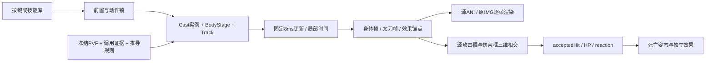

# 完整技能与战斗流程

以下说明足以配合包内代码复现当前实现。源数据事实、实机证据、重建推导和演示策略具有不同含义，不能把其中一种标成另一种。

## 两条链的连接

原客户端保存下来的链为：控制器特定调用点 → `0x162D2F0` 创建分发 → descriptor `+0x4D` 选择相对入口 `0x162D150` 或创建核心 `0x162C5E0` → 在相对入口内部由 `+0x4C` 决定是否叠加父位置/朝向。13次调用用保存的 E8 字节、返回地址、线程/ESP、父对象和ID核验。地址仅对保存版本有意义。

资源链为：`passiveobject.lst` 的 ID→OBJ绑定 → OBJ basic/etc motion、附加效果和PTL → ANI/ALS → 实机请求/构造区间内实际绘制 → 已配对的 flat→packet 消费。源引用不自动证明执行，构造不自动证明正在播放。创建返回实体与所有资源请求的直接父子关系、最终GPU提交仍有缺口。

独立程序不调用这些原生地址。数据生成器将确认的源引用/创建参数以及明确标注的校准、推导转成 `battle.json`，运行时以自己的施法实体和时间表执行。这样可以交接已知行为，又能在补齐控制器后替换时间表。

## 1. 启动、版本与资源

`main.cpp::run()` 从EXE目录加载内容；便携启动先核对资产清单绑定的源EXE身份与 `battle.json` 相同，再核对每个包内NPK的SHA256。资产以原始IMG字节重封装；原游戏EXE无需分发或执行。便携改动仅资源入口，完整 diff 在 `reference/portable-startup.patch`。

`Pvf`读取归一化缓存索引与成员范围。ANI为JSON中间格式；脚本仍为带两字节头的token5，标签/字符串使用缓存内字符串ID，保留源SHA256与record。`Assets`读取NPK目录、按逻辑路径定位IMG，存在多档同名时必须用 `profile.archive_overrides` 消除歧义。

解码 IMG 的压缩、像素格式、链接帧、裁剪原点等由 `resources.cpp` 完整实现；无需先导出PNG。`Canvas::sprite()` 将ANI自身原点与IMG裁剪原点放进几何变换，执行缩放/旋转/镜像、颜色和已支持混合。变换公式见 `geometry.hpp`。未知节点保留到反馈中，不能当作执行完毕。

## 2. 输入、施法状态与人物

主循环处理SDL事件，累积时间后每8ms更新一次；一次实际帧的累积最多100ms。失焦清理按住状态。方向移动归一化以避免对角更快，速度180单位/秒，限制在演示场地。人物具有平面X/Y、朝向、待机时钟和当前动作锁。

`startSpec()` 检查当前动作锁、Q狂暴前置和W关闭时间。每次施法创建唯一 `cast_id`，冻结起点/朝向，复制身体阶段和效果实例。身体阶段顺序来自映射的源ANI；动作锁与剩余效果寿命分离，人物结束动作后地面或爆炸效果仍可继续。怒气/血气爆发的锁长最多1000ms是本实现策略。

普通攻击使用身体 `attack1..3.ani`，狂暴使用 `frenzy1..4.ani`；按住/缓冲连段为演示控制。按W开启后持久Buff使用人物当前坐标与自身时钟，不要求重新请求资源。再次W关闭受10秒限制；用户已实测该限制，但内部原生谓词未恢复。

身体按 `profile.body_layers` 的12层固定外观绘制。太刀motion按身体ANI文件名映射，存在时使用太刀ANI；各层同步**身体帧索引**，并应用各自IMG替换。身体位置、武器位置及附层必须使用相同施法时钟。此规则复现当前外观，不代表完整原生装备/换装层树。

## 3. 效果时间与附层

`tools/prepare.py` 从当前版本重新绑定MOB/ACT/ANI，并建立八技能的效果时间表。A/S优先已确认的帧触发规则；其他缺少完整控制器的实例使用源图资格过滤后的首次/末次实际绘制进行校准。起点按身体附层或攻击框/末帧对齐的选择会写入来源；不能将构造时间统一当作播放起点。

有身体映射的其他主动技能使用 `skills.json` 的 `effects_timeline`；时间表为空时才使用有界ALS递归。已支持 `[use animation]`、非负帧 `[add]`、`[remove]` 及相对层序。源帧号先转为之前各帧DELAY之和；同一路径不同实例保留。负帧/缺失引用记录诊断，不能重写为0帧或近似文件名。当前递归是重建执行策略，不是被捕获的原生ALS解释器。

Track在 `[begin,end)` 内激活，局部时钟=`castAge-begin`；repeat由时间表决定。特效与人物/怪物先按深度，再按layer稳定排序。原始ANI自身图像位置永远参与最终投影。

## 4. 坐标、移动与崩山击落点

世界坐标采用 X水平、Y地面纵深、Z高度；演示投影 `screenX=X, screenY=Y-Z`。ANI图像原点不等于世界生成坐标。局部X需乘施法朝向，镜像攻击框需同时移动其最小角。

效果锚点：`actor`在当前施法运动位置，`spawn`固定在生成时的施法运动位置，`cast`固定施法原点。`point()`按锚点计算运动量和高度，再加 `Track.position`。当前actor绑定本次施法轨迹，并非动作锁结束后持续跟随玩家；只有狂暴常驻Buff明确使用人物实时坐标。

崩山击：角色前跳，帧4创建20050，局部XYZ为(123,1,0)，前后四层由OBJ与实际Back资源请求共同确认。应在生成时人物坐标上加朝向变换后的123，不能绑到脚底。内部参数27按源端点单精度插值/截断得水平90；前段至`t1`用80%距离，后段至`t2`补完，具体整数截断顺序在 `Motion::offset()`。

本实现高度用50/120端点和27插值得68，再用 `4*h*u*(1-u)` 抛物线。实机高度字段98无法由该端点直接得到，上游getter修正未恢复，所以68及曲线是已标注推导。血气之刃距离由SKL static[2]=170在charge区间推导，爆炸Z=60来自实际创建；浴血之怒Z=70同样有实机创建依据。

若只有绘制packet差值，生成器保留 `projection_only=true`，采用投影锚点；不能反推出唯一真实XYZ。大崩粒子采用首次绘制投影位置与已见时序，未恢复全轨迹/随机序列。数据导出会显示具体实例采用的basis。

## 5. 命中、受击与死亡

每8ms读取激活身体/武器/效果的源 `[ATTACK BOX]`，并读取怪物当前伤害帧 `[DAMAGE BOX]`。普通太刀普攻攻击框在武器ANI，身体ANI可能完全没有攻击框。框转换：面右 `X=originX+box.x`，面左 `X=originX-box.x-box.w`；Y/Z加对应偏移，三轴严格相交才命中。

重复节流键由 `cast_id/攻击实例/monster_id` 组成，间隔250ms；事件ID再去重。每次命中固定100伤害、怪物HP700，是演示结算策略。不同效果实例可以分别扣血；尚未合并为原生技能攻击组。`acceptedHit()` 检查generation、存活和eventId后扣血，非致死选damage1/2并从0计时，源反应时长结束回idle。

当前三个怪物配置由**当前技能快照**重新绑定：MOB motion直接取ANI；action取ACT的 `[BASE ANI]`；有 `[last action]` 时优先显式死亡。哥布林/猫妖有两类受击，石傀儡缺少绑定保留诊断但可扣血和执行显式死亡。

无显式死亡ACT时参考用户文档：保存当前姿态和渲染边界，60ms开始白化，220ms释放碎片，主体90ms淡出；碎片数/速度/重力/寿命来自当前PTL。随机初速度、飞行/落地、烟雾和共享时序属于文档重建策略；每实体独立粒子，不清共享只读资源。死亡后拒绝新命中，重置时generation更改以拒绝旧事件。

文档原版来自另一EXE；本包只复用渲染/状态管理规则和契约，没有移植其原生VA、HP编码或MOB绑定。血液等尚无闭合规则的分支不声称实现。
