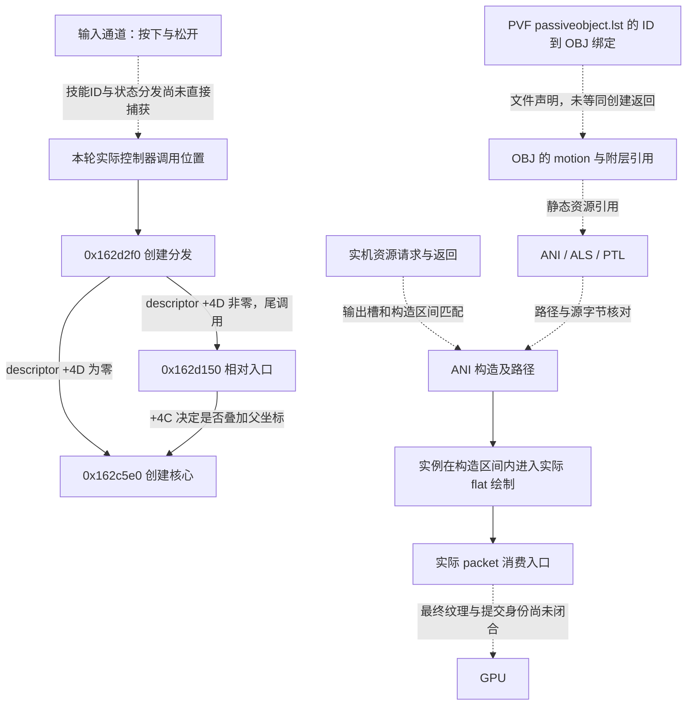

# 上一轮技能调用与特效链分析

本报告完成对上一轮已保存样本的逐技能审计与资源链整理。分析绑定 `DNF/DNF/DNF.exe`，EXE SHA256 为 `1f8244d3f7309bbe2fde4299e1863a894f6b28d5707bf01732980585b20b00dd`。依据为两个独立会话的原始内存回调、输入通道、保存的运行模块字节，以及运行内存 PVF 快照。没有用截图、资源文件名相似度或人工填写的播放时序代替调用证据。

**本轮样本分析完成，不表示完整技能引擎已恢复。** 已能核对特定控制器调用、创建参数、资源声明、动画构造与实际绘制；通用技能分发、部分内部执行入口及身体/武器完整身份仍有缺口。下文将可复用规则与这些缺口分别列出，作为战斗 demo 的接入依据。

## 证据包与复现

- [analysis-index.json](analysis-index.json)：逐技能入口、生成脚本哈希和验证范围。
- [sample-manifest.json](sample-manifest.json)：15 个技能采集窗口的资格、原始范围哈希、字节位置、序号、DLL/profile/会话身份。
- [source-graph.json](source-graph.json)：从本客户端 PVF 得到的有向资源引用、字段原始偏移、ANI 图片声明和 NPK 成员候选。
- [code-evidence.json](code-evidence.json)：创建分支、持续效果绘制、粒子配置路径和输入初始化的原始代码字节。
- [calibration-index.json](calibration-index.json)：移动、普通攻击与修正版待机基线的独立审计入口。
- [motion-parameter-review.json](motion-parameter-review.json)：崩山击按键时长、控制器参数与当前静态数据的逐项对照。
- [idle-status.json](idle-status.json)：最后一次只读状态检查；不宣称游戏已退出或 DLL 已卸载。
- [verification.json](verification.json)：原始范围重新计算哈希、静态代码身份及创建调用链检查结果。
- [report-consistency.json](report-consistency.json)：独立复核成员归档哈希、报告引用、异常样本排除、当前EXE版本和参数差异保留。
- `skills/*.json`：每个技能的原始序号、地址、坐标、调用位置、源文件绑定和动画构造区间。
- `sources/*.bin` 与相邻 JSON：解码前的 PVF 成员字节及有序 token/字段，保留重复标签和原始偏移。

运行 `D:/ProgramData/anaconda3/python.exe -X utf8 -B -S reverse_lab/v3/reports/live-tests/finalize_skill_analysis.py` 可重建这些机器报告。脚本读取现有归档与资源，不发送采集命令，不启动/注入/修改客户端。原始日志重新计算 SHA256；没有改写原始输入或内存事件。

## 样本资格

15 个技能窗口中，6 个完成了计划时长及本段输入检查，5 个提前结束但已有窗口无检测到的传输丢失，1 个包含 Q→W→Q 的混合输入，2 个发生队列溢出，1 个由用户要求排除。完整窗口只说明计划的观察区间完整，不能自动证明整个技能或对象生命周期已覆盖。

嗜魂封魔斩的用户反馈原文为：“这个技能没看到吸附效果。这个技能似乎有问题，忽略这个技能。”该段技术传输检查通过，但 `normal_skill_inference_eligible=false`，不进入下表的正常行为推导，不用于吸附、松键切换、结束效果或跨职业推广。原始数据及传输结果保留，排除决定另附于该段生成脚本和报告。

旧会话两段丢失窗口同样不进入正常行为建边。提前结束和混合输入窗口只使用已有的明确调用边，不用它们证明未观察到的末尾、单一输入谓词或完整清理。

## 总体链路与证据类型

实线不表示所有相邻方框都已恢复完整函数体；具体边的约束见机器报告。创建核心到返回对象、请求到构造的直接父子关系、以及最终 GPU 绑定没有被补成虚假因果边。

已验证创建调用的规则使用实际返回地址，并用保存模块中的 `E8` 字节复算目标；还核对线程、入口 ESP、descriptor 地址、父对象和 ID。资源请求/返回使用同线程、原始入口 ESP 与输出槽。flat→packet 使用连续线程序号、已核对的返回地址、ESP 差、动画地址、packet 地址及原参数字节。仅时间接近不建立调用边。

同一 ANI 地址可被反复构造。所有路径统计限定于“本次构造入口至该地址下一次构造/窗口结束”，不能把早期另一资源的绘制累计给后来的路径；这个区间也不等同构造成功返回至析构的生命周期。

还有一条可用于后续追踪的直接内存对应：13次有效创建中，descriptor `+0x50` 的DWORD均与该段标注技能的SKL列表ID相等，包括后续喷发的20044仍携带81。机器报告保存原值和逐项对照，将它标为“候选来源技能标识”。目前没有直接捕获其写入者/消费者，也未证明所有创建都采用这一语义，不能据此把按键或整个技能分发改标为已确认。

## 创建坐标：两个独立控制位

此次复核补清了此前说明中容易混用的两个字节：

| 字段 | 代码证据 | 行为 |
| --- | --- | --- |
| descriptor `+0x4D` | `0x162d32d` 检查，`0x162d338` 尾跳 | 决定分发是否进入相对入口；为零时从 `0x162d33d` 直接调用核心 |
| descriptor `+0x4C` | 相对入口复制体的 `0x162d1cd` 检查 | 在相对入口内部决定是否将父 X/Y/Z、朝向加入传入坐标 |

当 `+4D=1,+4C=1`，代码解析方向后对 X 做朝向变换，再加入父坐标，Y/Z 分别累加；当 `+4D=1,+4C=0`，经过相对入口但保持传入坐标；当 `+4D=0`，直接进入核心。只观察到的三种组合见下表，未把未测组合当作实机结果。

| 实例 | +4C | +4D | 实测输入 → 核心坐标 |
| --- | ---: | ---: | --- |
| 崩山击 20050，两次 | 1 | 1 | `(123,1,0)` → `(893,225,0)` / `(714,224,0)` |
| 十字斩 20028 | 1 | 1 | `(85,0,82)` → `(566,223,82)` |
| 血气之刃 20066 | 0 | 1 | `(558,224,60)` → `(558,224,60)` |
| 浴血之怒 38002 | 1 | 1 | `(0,0,70)` → `(388,223,70)` |
| 怒气爆发，三实体 | 1 | 1 | `(0,0,0)/(0,50,0)/(0,0,0)` → `(388,223,0)/(388,273,0)/(388,223,0)` |
| 血气爆发，三实体 | 1 | 1 | 与上行本次参数安排相同，但控制器和 ID 不同 |
| 崩山裂地斩 20043 | 1 | 1 | `(150,0,0)` → `(846,219,0)` |
| 崩山裂地斩 20044 | 0 | 0 | `(846,219,0)` → `(846,219,0)`，直接创建核心 |

这些是参数实例，不是全部技能的固定偏移。渲染时还应分别处理世界 XYZ、镜头投影、ANI 自身原点与附层位置。崩山击冲击波应使用生成时的人物位置和控制器传入的局部点，不能统一绑定脚底，也不能以“武器贴图最下方像素”替代创建坐标。

## 逐技能调用与特效

表内数字属于对应采集窗口，包含当时背景或同时存在的效果，不自动代表该技能独占的全部资源。构造、实际进入 flat 的构造区间、严格 flat→packet 对数是三个不同量。

| 技能 / 报告 | 已验证的创建 ID | 窗口内构造 / 有 flat 区间 / 严格配对 | 结论边界 |
| --- | --- | --- | --- |
| [崩山击](skills/hopsmash.json) | 20050 | 首次 6/6/725；重测 6/6/762 | 首次提前结束；重测满6秒。首次用户确认动作、地波正常且未命中 |
| [血之狂暴](skills/frenzy.json) | 本段没有据此补造实体创建 | 新会话开启 5/5/2231 | 开启、普攻及关闭分开保存；身体/武器全层并未恢复 |
| [十字斩](skills/gorecross.json) | 20028 | 14/12/2619 | 提前结束且命中怪物；公共斩击/血花不因相邻时间自动归属技能 |
| [血气之刃](skills/bloodsword.json) | 20066 | 5/5/660 | Q→W→Q；用户确认刺击、爆炸出现。不能作为未开启狂暴时的单次成功样本 |
| [浴血之怒](skills/bloodboom.json) | 38002 | 28/27/4179 | 7.19秒提前结束；用户确认爆炸正常、未命中 |
| [怒气爆发](skills/bloodblast.json) | 20122、20120、20121 | 重试 17/15/7602 | 重试满8秒且本段无新增丢失；第一次丢失且无D输入的窗口作废 |
| [血气爆发](skills/bloodblastex.json) | 20103、20102、20104 | 27/24/9152 | H按住约2.662秒，5.89秒切出；嗜血状态及内部松键谓词未知 |
| [崩山裂地斩](skills/outragebreak.json) | 20043、20044 | 新会话 102/94/12879 | 满12秒；用户确认砸地、冲击波、喷发正常且未命中。旧丢失段作废 |

### 崩山击：人物移动、生成点与前后层

`0x20bec22` 的调用字节指向创建分发；原始 descriptor、相对入口和核心参数可串联。20050 经 `passiveobject.lst` 对应 `HopSmashSub.obj`，文件给出 Front 动画与附加效果，客户端 `0x124f080` 的后层更新另请求 Back1/Back2。六条实际资源路径都进入绘制，部分 Back 资源 pair 还进入 drawonly 构造、场景附加和销毁观察。

人物控制器直接记录了人物地址、身体 ANI 指针、状态和位移参数。首次控制器进入状态1后，内部输入参数35、水平距离102、高度字段104；重测为27、90、98。输入通道实际按住 A 约89.206ms、75.506ms，两者与内部参数不相等，不能直接用外部按住时长替换 `+0x6EA4`。

源码读取索引2/3后，以100为分母调用单精度插值并截断，水平距离与50/200端点、参数35/27相符。索引4/5的读取和高度字段写入也有代码证据，但当前快照的50/120端点不能直接得到实测104/98；技能 getter 的上游修正未捕获。这一差异保留为缺口，不根据数值相差30就发明补偿项。完整垂直曲线和地图碰撞同样没有恢复。

### 血之狂暴：持续动画不依赖本段重新加载

新会话实际观察到 Cast、Blast、两个 EndofCasting 和 Buff 的构造与绘制。旧会话后续普攻、关闭窗口没有新的资源请求/构造，但可观察到对应驻留地址及资源身份的绘制。`0x1B0F2D1` 从内部字段取 ANI 调用 flat，实际返回地址为 `0x1B0F2D6`；它不同于崩山击附层的入口。

旧会话关闭窗口中，该 ANI 最后绘制约为 W 按下后0.397ms，此后至窗口末尾不再出现；这证明该窗口中的绘制停止，不证明析构。不同窗口之间有未采样区间，地址重复不构成连续生命周期证明。“开启10秒内不能关闭”保留为用户实测，内部条件没有被补写成原生规则。

### 十字斩与血气之刃：身体附层、实体与缓存必须分别处理

十字斩的角色 Slash1..4 都实际绘制；实体 GoreCross1/2 也绘制，GoreCross3/4 只有本段构造，不能当作已发动追加攻击。20028 的来源绑定、代码调用与坐标已核对；20069 变体只保留此前静态分支证据。

血气之刃的爆炸对象20066进入相对入口但不加父位置。`dust.ani`、`exp.ani`、`exp_dodge.ani` 实际绘制。身体 `bloodswordcharge.ani.als` 的 dust 命令位于源偏移120，原值 `[8,"dust",0,1,0]`；这是文件命令，尚未直接监测其通用执行入口，不能用解析回调冒充执行回调。charge、charge_body、charge_dodge 的声明也被归档；它们可能涉及驻留动画，不能用“本段无构造”判为不存在或擅自关联未知身体地址。

### 怒气爆发与血气爆发：多实体和前后层

两技能的三组实际创建 ID 分别与各自 SKL `[usable passiveobject]` 一致，ID再由列表映射到不同 OBJ。主体、地面、前后子层分别通过 basic motion / etc motion / ALS 和通用绘制入口参与组合；二者不能因坐标相似就共用同一个状态控制器。

血气爆发的 `BlastBlood1Ex.ani` flat 区间约2091.940—4735.752ms；H于4730.741ms松开，`BlastBloodExEnd.ani` 从4740.144ms才进入绘制。该结束动画在更早已经构造，说明构造时刻不能用作播放时刻。这是输入与绘制的时序对照，内部松键条件、嗜血改变持续方式的运行谓词仍未直接观察。

另有确定的文件缺口：`BlastBlood1Ex.ani.als` 原偏移180声明 `BlastBloodEx/sub_dodge.ani`，该成员在当前快照不存在；实机从 OBJ 资源请求入口加载了 `sub_dodge1.ani`、`sub_dodge2.ani`。两个存在的文件不能自动当作那条失效声明的同义替换；应保留来源并分别实现有证据的调用。

### 浴血之怒与崩山裂地斩：负帧、代码效果和粒子

浴血之怒的38002映射到 `BloodBoomFinish.obj`。实际构造包含地面血层、前后线条、冲击波、圆环和闪屏等；`readyfinish...casting.ani` 本段只有构造。身体 ALS 中四条 add 的帧值为-1，源偏移110、150、170、190，不能改成第0帧执行。

崩山裂地斩的20043和20044来自实际调用，不来自该 SKL 的可用对象列表。20043→`OutRageBreakFloor.obj`，20044→`OutRageBreakBloodExp.obj`；后续对象使用已经得到的世界位置直接创建。102次构造包含重复路径和粒子实例，不是102种效果。

进一步从保存的代码解出两条实际存在的配置路径：`particle/outragebreak_drops.ptl` 和 `particle/outragebreak_light_part.ptl`；它们在 `0x1C36E83`、`0x1C36EF6` 参与路径选择，后续代码调用 `0x22DF6D0`。PTL `[object]` 指向的 drops1/2、light_part1/2 ANI 与实机粒子资源请求相符。石块PTL的代码字符串也单独归档。配置字段的频率、数量、寿命、区域和原始重复引用全部保留。

这补充了“代码选择PTL → PTL声明ANI → 实机请求并绘制该ANI”的证据关系；PTL构造/随机选择/更新/销毁入口尚未直接监测，不能据此宣布整个粒子解释器、随机序列或各字段单位已恢复。DS分支字符串和非DS分支同时存在，分支谓词返回值没有被本轮直接采到。

## 人物、武器及其他未闭合环节

移动与普攻校准已有独立报告；人物位置分量、方向写请求、主 ANI、部分绘制对象与 packet 可直接观察。崩山击控制器的人物地址可与该会话绘制/位置字段相互核对。写请求不是提交成功或位移积分证明。

身体主 ANI 经常早已加载，构造窗口中没有路径；当前不能为每个身体指针可靠命名。太刀是用户确认的装备条件，flat 入口 ESI 相等也只是一条寄存器观察，不能直接认定完整武器层。武器自身动作映射、身体染色、替换/附加武器、时装掩码与层序仍需更直接的 getter/绑定入口证据。

尚缺的关键环节如下；这些不能通过把既有截图贴到演示器来补足：

1. 技能ID、等级、成长职业和状态转换的通用分发/成功返回；输入意图和SKL学习前置不替代运行谓词。
2. 通用 ALS 命令执行器，尤其负帧、drawonly 创建/移除及原生命名对象生命周期。
3. PTL控制器的初始化、时钟、随机选择、运动和结束；REP解码/回放在本轮技能链中的作用。
4. 核心创建的真实返回对象、附加成功返回、完整析构/删除事件及延迟任务。
5. 已缓存身体、武器和效果ANI的稳定源身份与其完整层级。
6. NPK/IMG/帧索引到实际GPU纹理/提交的完整绑定；目录成员候选和文件读取不能代替这一身份链。

## 对战斗 demo 的约束

本轮新增的是证据分析与可复现报告，尚未改 demo。后续实现应将角色控制器、创建坐标、只绘制对象、持续附层和粒子实例分开；只有经过证据核对的规则进入技能控制器，其他资源可保留为有标注的预览，不能标成完整还原。原始攻击判定和怪物受击模块不因本轮分析而被覆盖。

用户新增的怪物受击死亡交接文档已读取。它绑定的 EXE 为 `246b8381…`，本次技能客户端为 `1f8244d3…`，是不同来源版本。后续可按交接契约复用已认可的受击/冻结/碎裂视觉策略，但其原生地址和资源哈希不能直接用于本次技能客户端；需保持版本分离或重新绑定当前资源。文档明确标作重建参数的死亡延迟和粒子布局，也应继续保留这一属性。
